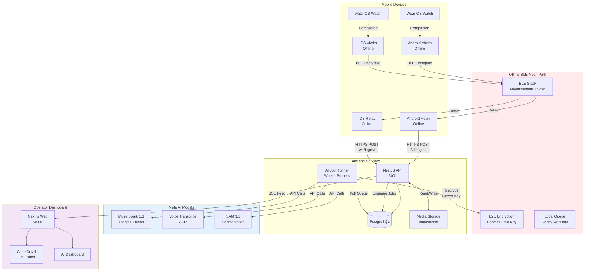
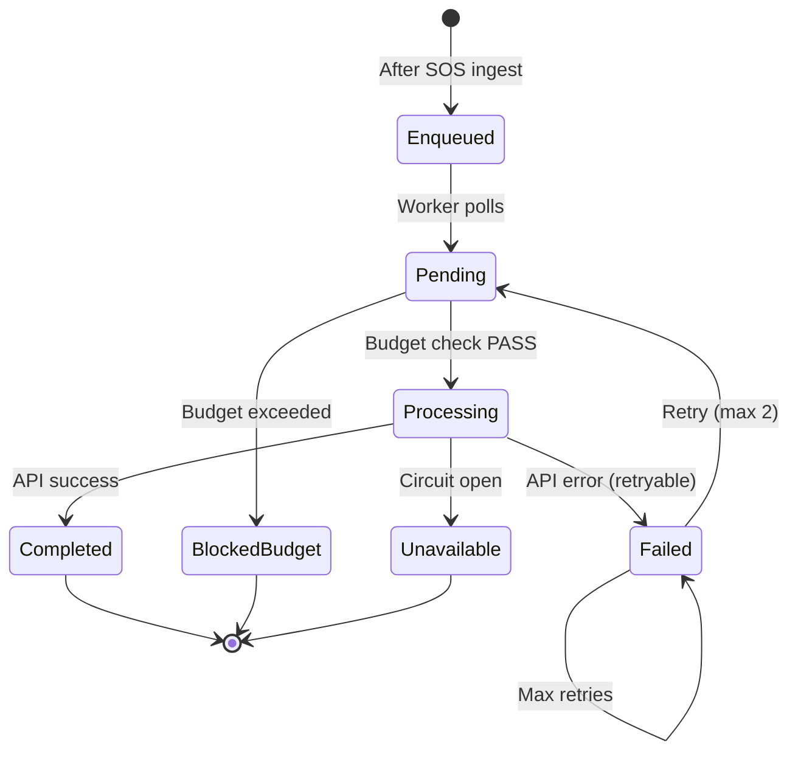
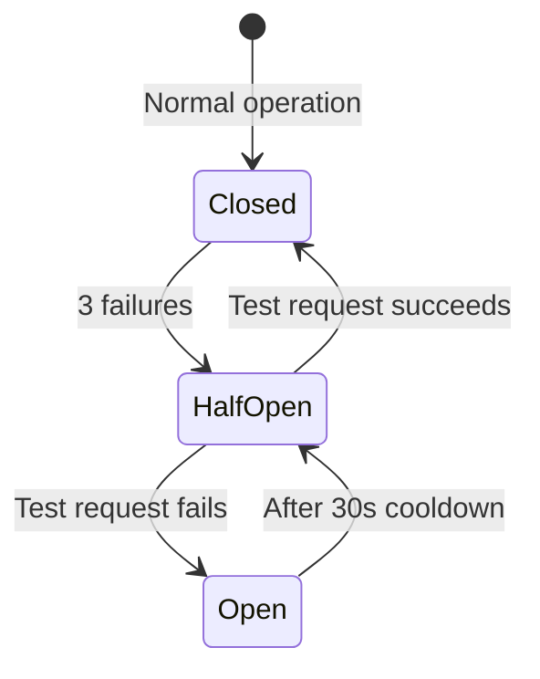

# SOSMesh System Architecture

**Meta AI Hackathon 2026 — Disaster Intelligence Platform**

---

## Executive Summary

SOSMesh is a multimodal AI-powered disaster response platform with an **offline-first BLE mesh** for emergency communication when infrastructure fails. The system combines device-to-device message relay, server-side AI intelligence (Meta AI models), and an operator dashboard for coordinated response.

**Core Innovation:** AI-augmented disaster intelligence with zero AI dependency for critical message delivery.

---

## High-Level Architecture



---

## 1. Offline BLE Mesh Path

### Purpose

Enable SOS message transmission when cellular and internet infrastructure is unavailable.

### Flow

1. **Victim Device (Offline)**
   - User creates SOS message (text, voice, photo)
   - App encrypts payload with **server public key** (E2E)
   - Creates outer envelope with routing metadata (messageId, TTL, hop count)
   - Advertises BLE packet with message UUID
   - Stores in local queue (Room DB / SwiftData)

2. **Relay Device (BLE + Internet)**
   - Scans for BLE advertisements
   - Detects SOS message UUID
   - Requests full encrypted payload via BLE
   - Stores encrypted envelope (cannot decrypt)
   - Queues for HTTPS upload

3. **No Internet Dependency**
   - Message stored locally if no relay available
   - Retries when relay device comes in range
   - No server, API, or AI calls during BLE transfer
   - Works in airplane mode + BLE enabled

### Encryption Boundaries

```
┌────────────────────────────────────────────────────┐
│ Victim Device (A)                                  │
│ 1. Create SOS plaintext                            │
│ 2. Encrypt with SERVER_PUBLIC_KEY → ciphertext    │
│ 3. Wrap in envelope with routing metadata         │
└────────────────────────────────────────────────────┘
              ↓ BLE Transfer (ciphertext)
┌────────────────────────────────────────────────────┐
│ Relay Device (B)                                   │
│ ❌ CANNOT decrypt (no private key)                 │
│ ✅ Sees: messageId, TTL, hop count                 │
│ ❌ Cannot see: SOS text, location, person count    │
└────────────────────────────────────────────────────┘
              ↓ HTTPS POST (ciphertext)
┌────────────────────────────────────────────────────┐
│ Backend API (Server)                               │
│ ✅ Decrypts with SERVER_PRIVATE_KEY                │
│ ✅ Sees: SOS text, location, person count          │
│ ✅ Enqueues AI job (optional)                      │
└────────────────────────────────────────────────────┘
```

**Privacy Guarantee:** Relay volunteers **cannot read SOS content**. Only server-side decryption.

---

## 2. Online Upload Path

### Flow

1. **Relay Device → Backend**
   - HTTPS POST to `/v1/ingest`
   - Payload: encrypted envelope + relay metadata
   - Auth: None (public ingest endpoint)
   - Response: Signed server receipt

2. **Backend Ingestion**
   - Validate envelope structure
   - Check for duplicate (messageId uniqueness)
   - Decrypt inner payload with `SOSMESH_SERVER_SOS_PRIVATE_KEY`
   - Store in `sos_messages` table
   - Generate `incidents` record
   - Return signed receipt to relay
   - Enqueue AI job (if `AI_ENABLED=true`)

3. **Server Receipt**
   ```json
   {
     "receipt": {
       "ackType": "SERVER_ACCEPTED",
       "messageId": "uuid",
       "timestamp": "ISO8601",
       "signature": "HMAC-SHA256(messageId + timestamp)"
     }
   }
   ```

4. **Relay → Victim Acknowledgment**
   - Relay broadcasts BLE acknowledgment
   - Victim device updates status to `PEER_RECEIVED`
   - **Note:** This does NOT mean operator has seen the case
   - `OPERATOR_SEEN` is a separate event when case detail page is opened

### Endpoint Security

**Ingestion:**
- No authentication required (disaster scenario)
- Rate limiting per relay device hash
- Signature validation on envelope
- Replay attack prevention (timestamp + nonce)

**Operator:**
- JWT bearer token required
- Role-based access control (RBAC)
- Audit logging for all actions

---

## 3. Server-Side Decryption

### Key Management

**Server Keys:**
- `SOSMESH_SERVER_SOS_PRIVATE_KEY` — Ed25519 private key (base64)
- `SOSMESH_SERVER_SOS_KEY_ID` — Key identifier for rotation

**Mobile App Embedded:**
- `SOSMESH_SERVER_SOS_PUBLIC_KEY` — Server public key (hardcoded in app)
- Used by victim devices to encrypt SOS payload

### Decryption Service

**File:** `apps/api/src/ai/sos-plaintext-source.ts`

```typescript
export interface SosPlaintextSource {
  getPlaintext(messageId: string): Promise<string | null>;
}

class ServerKeyPlaintextSource implements SosPlaintextSource {
  async getPlaintext(messageId: string): Promise<string | null> {
    const encryptedPayload = await db.getEncryptedPayload(messageId);
    return decryptWithServerKey(encryptedPayload);
  }
}
```

**Usage:**
- AI worker calls `plaintextSource.getPlaintext(messageId)`
- Decryption happens **in-memory only**
- Plaintext never logged or stored unencrypted
- Sent to Meta AI API over HTTPS

**Security:**
- Private key stored in environment variable (never in repository)
- Key rotation supported via `KEY_ID` versioning
- Decryption failures logged (without payload)

---

## 4. AI Job Pipeline

### Job Queue Architecture

**Database Table:** `ai_jobs`

```sql
CREATE TABLE ai_jobs (
  id UUID PRIMARY KEY,
  kind TEXT NOT NULL,  -- 'triage', 'transcribe', 'vision', 'fusion'
  incident_id UUID NOT NULL,
  status TEXT NOT NULL,  -- 'pending', 'processing', 'completed', 'failed'
  payload JSONB,
  result JSONB,
  reserved_cost_usd DECIMAL,
  actual_cost_usd DECIMAL,
  created_at TIMESTAMP,
  completed_at TIMESTAMP
);
```

**Job Lifecycle:**



### Job Kinds

1. **triage** — Muse Spark analysis of SOS text
   - Input: SOS plaintext (decrypted)
   - Output: urgencySuggestion, needs, hazards, summary
   - Chaining: Enqueues `fusion` job after completion

2. **transcribe** — Voice Transcribe audio-to-text
   - Input: Audio file path (WAV 16kHz)
   - Output: Transcript with turns, timestamps
   - Chaining: Enqueues `triage` job with transcript text

3. **vision** — Muse Spark + SAM 3.1 photo analysis
   - Input: Image file path (JPEG/PNG)
   - Output: Spark description + SAM segments
   - Chaining: None (terminal)

4. **fusion** — Signal fusion rationale
   - Input: Pair of incident IDs
   - Output: Semantic similarity rationale
   - Chaining: None (operator action required)

### Worker Process

**File:** `apps/api/src/ai/ai-job-runner.service.ts`

**Startup:**
- Runs only when `AI_ENABLED=true`
- Polls job queue every 2 seconds
- Concurrent job limit: 5 (configurable)

**Job Processing:**
1. Poll `ai_jobs` table for `status='pending'`
2. Update status to `processing`
3. Check budget guard (pre-flight)
4. Call appropriate service (triage/transcribe/vision/fusion)
5. Save result to database
6. Update job status to `completed`
7. Enqueue chained job if applicable

**Error Handling:**
- Retryable errors (429, 5xx): Mark `failed`, increment retry count
- Non-retryable errors (400, 401, 403): Mark `unavailable`
- Budget exceeded: Mark `blocked_budget`
- Circuit open: Mark `unavailable`, skip queue

---

## 5. AI Budget Guard

### Purpose

Prevent runaway costs from AI API calls.

### Implementation

**Database Table:** `ai_usage_ledger`

```sql
CREATE TABLE ai_usage_ledger (
  id UUID PRIMARY KEY,
  job_id UUID REFERENCES ai_jobs(id),
  model TEXT NOT NULL,
  input_tokens INT,
  output_tokens INT,
  reasoning_tokens INT,
  cost_usd DECIMAL NOT NULL,
  created_at TIMESTAMP
);
```

**Service:** `apps/api/src/ai/budget-guard.service.ts`

**Budget Enforcement:**

1. **Pre-Flight Check:**
   ```typescript
   const estimatedCost = 0.002; // $0.002 per triage
   const canProceed = await budgetGuard.checkAndReserve(estimatedCost);
   if (!canProceed) {
     throw new BudgetExceededError();
   }
   ```

2. **Post-Flight Reconciliation:**
   ```typescript
   const actualCost = calculateCost(response.usage);
   await budgetGuard.recordActual(jobId, actualCost);
   ```

3. **Pessimistic Locking:**
   - Use database transactions with row-level locks
   - Prevent race conditions in concurrent workers
   - Daily budget resets at UTC midnight

### Budget Limits

**Default:**
- Daily: $30 USD
- Total: $150 USD

**Configurable:**
```bash
AI_DAILY_BUDGET_USD=30
AI_TOTAL_BUDGET_USD=150
```

**When Exceeded:**
- New jobs marked `blocked_budget`
- Dashboard shows "AI unavailable (budget)"
- SOS ingestion continues normally
- Manual reset required for total budget

---

## 6. Operator Panel

### Dashboard Components

#### Case List View (`/operator`)

- Real-time SSE feed from backend
- Map view with incident markers
- List view with filters (urgency, type, status)
- Search by messageId, text
- Pagination + infinite scroll

#### Case Detail View (`/operator/cases/:id`)

**Left Panel:**
- Original SOS text
- Timestamp, location (if available)
- Person count, contact info
- Status timeline (5 stages)

**Right Panel (AI Intelligence):**
- AI status badge (processing/completed/failed)
- Triage card (urgency, needs, hazards)
- Transcript card (audio player + turns)
- Photo analysis card (SAM overlay)
- Fusion suggestions (link/unlink buttons)
- Operator override controls

#### AI Dashboard (`/operator/ai`)

**Status Card:**
- AI system enabled/disabled
- Circuit breaker state
- Budget used (daily/total)
- Queue depth, last analysis
- Model availability (Spark ✓, Voice ✓, SAM ✓)

**Mission Copilot Card:**
- Chat interface for operator queries
- Cited incident links
- Uncertainty warnings
- Next steps suggestions

**Demo SOS Form:**
- Create synthetic test data
- Upload text, audio, photo
- Big warning: "DEMO DATA"

---

## 7. Database Schema

### Core Tables

**sos_messages:**
- `message_id` (UUID, PK)
- `encrypted_payload` (BYTEA)
- `note_text` (TEXT, nullable) — decrypted text
- `encrypted_note_blob` (BYTEA, nullable) — encrypted audio/photo
- `synthetic` (BOOLEAN, default false)
- `created_at`, `received_at`

**incidents:**
- `id` (UUID, PK)
- `message_id` (UUID, FK)
- `status` (TEXT) — 'LOCAL_SAVED', 'PEER_RECEIVED', 'SERVER_ACCEPTED', etc.
- `urgency` (TEXT) — 'critical', 'high', 'medium', 'low', 'unknown'
- `operator_urgency_override` (TEXT, nullable)
- `location` (POINT, nullable)
- `person_count` (INT, nullable)

**ai_analyses:**
- `id` (UUID, PK)
- `incident_id` (UUID, FK)
- `urgency_suggestion` (TEXT)
- `needs` (TEXT[])
- `hazards` (TEXT[])
- `missing_info` (TEXT[])
- `source_quotes` (TEXT[])
- `follow_up_questions` (TEXT[])
- `brief_summary` (TEXT)
- `translation` (JSONB, nullable)

**ai_transcripts:**
- `id` (UUID, PK)
- `attachment_id` (UUID, FK)
- `model` (TEXT) — 'muse-voice-transcribe-1.0'
- `transcript` (TEXT)
- `turns` (JSONB) — [{ turnId, startMs, endMs, transcript, speaker }]
- `language` (TEXT)
- `duration_ms` (INT)

**ai_vision_analyses:**
- `id` (UUID, PK)
- `attachment_id` (UUID, FK)
- `spark_summary` (TEXT)
- `sam_segments` (JSONB) — [{ id, confidence, boundingBox, mask }]

**incident_link_suggestions:**
- `id` (UUID, PK)
- `incident_a_id` (UUID, FK)
- `incident_b_id` (UUID, FK)
- `score` (DECIMAL) — deterministic score (0.0-1.0)
- `rationale` (TEXT) — AI-generated explanation
- `status` (TEXT) — 'pending', 'confirmed', 'rejected'

**attachments:**
- `id` (UUID, PK)
- `incident_id` (UUID, FK)
- `sha256` (TEXT, unique)
- `mime_type` (TEXT)
- `size_bytes` (BIGINT)
- `duration_ms` (INT, nullable)
- `synthetic` (BOOLEAN)
- `expires_at` (TIMESTAMP)

**ai_jobs:**
- `id` (UUID, PK)
- `kind` (TEXT) — 'triage', 'transcribe', 'vision', 'fusion'
- `incident_id` (UUID, FK)
- `status` (TEXT)
- `payload` (JSONB)
- `result` (JSONB)

**ai_usage_ledger:**
- `id` (UUID, PK)
- `job_id` (UUID, FK)
- `model` (TEXT)
- `input_tokens` (INT)
- `output_tokens` (INT)
- `reasoning_tokens` (INT)
- `cost_usd` (DECIMAL)

---

## 8. Deployment Architecture

### Development Environment

```
┌─────────────────────────────────────────┐
│ Developer Laptop                        │
├─────────────────────────────────────────┤
│ Docker Compose:                         │
│   - PostgreSQL (port 5432)              │
│   - Redis (optional, port 6379)         │
│                                         │
│ Node.js:                                │
│   - API (port 3001)                     │
│   - Worker (background process)         │
│   - Web Dashboard (port 3000)           │
│                                         │
│ Mobile:                                 │
│   - Android Emulator + 2 Physical       │
│   - iOS Simulator (macOS only)          │
└─────────────────────────────────────────┘
```

### Staging / Hackathon Demo

```
┌─────────────────────────────────────────┐
│ Cloud Instance (e.g., DigitalOcean)     │
├─────────────────────────────────────────┤
│ Docker Compose:                         │
│   - PostgreSQL (managed)                │
│   - NestJS API container                │
│   - Worker container                    │
│   - Next.js SSR container               │
│   - Caddy reverse proxy (HTTPS)         │
│                                         │
│ Secrets:                                │
│   - MODEL_API_KEY (Meta AI)             │
│   - SOSMESH_SERVER_SOS_PRIVATE_KEY      │
│   - DATABASE_URL                        │
└─────────────────────────────────────────┘
```

**Deployment File:** `infra/deploy/compose/docker-compose.vulut.yml`

**Environment Variables:**
```bash
# Production variables (no defaults in compose)
MODEL_API_KEY=${MODEL_API_KEY}
SOSMESH_SERVER_SOS_PRIVATE_KEY=${SOSMESH_SERVER_SOS_PRIVATE_KEY}
DATABASE_URL=${DATABASE_URL}
AI_ENABLED=${AI_ENABLED:-false}
AI_DAILY_BUDGET_USD=${AI_DAILY_BUDGET_USD:-30}
TRUST_PROXY=${TRUST_PROXY:-2}
```

---

## 9. Security Architecture

### Threat Model

**Threats:**
1. **Relay device compromise** — Attacker steals encrypted payloads
2. **Man-in-the-middle** — Attacker intercepts HTTPS traffic
3. **API key theft** — Attacker steals Meta AI key
4. **Budget exhaustion** — Attacker floods AI jobs
5. **Prompt injection** — Malicious SOS text tries to manipulate AI

**Mitigations:**
1. **E2E encryption** — Relay cannot decrypt SOS content
2. **HTTPS only** — TLS 1.3 for API communication
3. **Key management** — Secrets in environment variables, never in repo
4. **Budget guard** — Hard caps with database-backed ledger
5. **Prompt engineering** — System prompts enforce grounding, no execution

### Data Flow Security

```
┌────────────────────────────────────────┐
│ Victim Device                          │
│ Plaintext SOS: "Help, 3 people trapped"│
│ ↓ Encrypt with SERVER_PUBLIC_KEY       │
│ Ciphertext: [binary blob]              │
└────────────────────────────────────────┘
            ↓ BLE (ciphertext)
┌────────────────────────────────────────┐
│ Relay Device                           │
│ ❌ Ciphertext only (cannot decrypt)    │
│ ✅ Routing: messageId, TTL             │
└────────────────────────────────────────┘
            ↓ HTTPS (ciphertext)
┌────────────────────────────────────────┐
│ Backend API (TLS 1.3)                  │
│ ✅ Decrypt: SERVER_PRIVATE_KEY         │
│ ✅ Plaintext: "Help, 3 people trapped" │
│ ↓ Send to Meta AI (HTTPS)              │
│ ❌ No GPS, device ID, phone number     │
└────────────────────────────────────────┘
            ↓ HTTPS
┌────────────────────────────────────────┐
│ Meta AI API                            │
│ ✅ Receives: SOS text only             │
│ ❌ No location, device ID, PII         │
│ Returns: {urgency, needs, summary}     │
└────────────────────────────────────────┘
```

**Privacy Guarantees:**
- Relay devices: See routing metadata, **not SOS content**
- Meta AI: Receives SOS text, **not GPS/device ID/PII**
- Logs: PII redacted with `[REDACTED_TEXT]` masks
- Operator: Full access (RBAC enforced)

---

## 10. Fallback and Resilience

### Circuit Breaker

**Thresholds:**
- Failures: 3 consecutive
- Cooldown: 30 seconds
- Half-open test: 1 request

**States:**


**Behavior:**
- **Closed:** All requests pass through
- **Open:** Reject immediately, mark jobs `unavailable`
- **Half-Open:** Allow 1 test request

### Graceful Degradation

**When AI unavailable:**
1. **SOS ingestion continues** — Message stored, operator notified
2. **Dashboard shows badge** — "AI unavailable (circuit open)"
3. **Manual triage** — Operator assesses urgency manually
4. **No blocking** — Cases viewable, assignable, manageable

**When budget exceeded:**
1. **Jobs marked `blocked_budget`**
2. **Dashboard shows cap** — "Daily budget: $30.00 / $30.00 (100%)"
3. **Manual reset** — Operator/admin increases cap or waits for reset

**When decryption fails:**
1. **Job marked `unavailable`**
2. **Encrypted payload preserved** — Can retry with key rotation
3. **Operator sees error** — "Decryption failed (key mismatch)"

---

## 11. Observability

### Metrics

**Prometheus Endpoints:**
- `sosmesh_sos_ingested_total` (counter)
- `sosmesh_ai_jobs_enqueued_total` (counter by kind)
- `sosmesh_ai_jobs_completed_total` (counter by kind, status)
- `sosmesh_ai_budget_used_usd` (gauge, daily/total)
- `sosmesh_ai_queue_depth` (gauge)
- `sosmesh_meta_api_latency_seconds` (histogram)
- `sosmesh_circuit_breaker_state` (gauge: 0=closed, 1=open, 0.5=half-open)

### Structured Logging

**Format:** JSON (Pino)

**Fields:**
- `correlationId` — `messageId` for full trace
- `level` — info, warn, error
- `timestamp` — ISO8601
- `service` — api, worker, web
- `event` — sos_ingested, ai_job_completed, etc.

**PII Redaction:**
```json
{
  "correlationId": "550e8400-e29b-41d4-a716-446655440000",
  "event": "sos_ingested",
  "location": "[REDACTED_GPS]",
  "noteText": "[REDACTED_TEXT]"
}
```

### Alerts

**Critical:**
- API health check fails (3 consecutive)
- Database connection pool exhausted
- Budget exceeded and jobs pending

**Warning:**
- Meta AI 5xx rate > 10%
- Circuit breaker open > 5 minutes
- AI queue depth > 50 jobs

---

## 12. Scalability and Performance

### Current Capacity (M0 Hackathon)

- **SOS/hour:** 10-20 (demo load)
- **Operators:** 2-3 concurrent
- **Physical devices:** 2 Android tested
- **Backend:** Single instance (4 CPU, 8 GB RAM)
- **Database:** PostgreSQL (single node)

### Future Scaling (Production)

**Horizontal Scaling:**
- API: 3+ instances behind load balancer
- Worker: 2+ instances with distributed queue
- Database: Read replicas for operator queries
- Media storage: S3 or object storage

**Caching:**
- Redis for SSE sessions, rate limiting
- In-memory LRU for incident summaries
- CDN for operator dashboard assets

**Performance Targets:**
- API p99 latency: < 500ms
- AI job completion: < 30s (triage)
- SSE feed latency: < 2s
- Dashboard load time: < 3s

---

## 13. Known Limitations

### Offline BLE Mesh

1. **Apple background restrictions** — iOS/watchOS may not scan in background when force-quit
2. **No guarantee of mesh coverage** — Depends on relay device density and platform behavior
3. **Physical device testing required** — BLE mesh only proven on real hardware

### AI Features

1. **Turkish accuracy not live-tested** — Voice transcribe verified for English only
2. **SAM cannot assess structural safety** — Shows visible objects only
3. **No guarantee of inference** — Budget caps may block AI jobs

### System Guarantees

1. **No 112/911 replacement** — Experimental prototype, not production-ready
2. **Peer ACK ≠ operator seen** — `PEER_RECEIVED` only confirms relay delivery
3. **No auto-assignment** — AI suggests, operators approve
4. **Demo data labelled** — Synthetic SOSs marked, not mixed with real emergencies

---

## 14. Red Lines Summary

### What SOSMesh Does NOT Do

❌ Replace official emergency services (112/911)  
❌ Guarantee BLE mesh under Apple force-quit  
❌ Prove physical BLE without real device tests  
❌ Let relay devices read SOS content  
❌ Make AI triage decisions without operator approval  
❌ Auto-merge linked incidents  
❌ Guarantee Meta AI inference (budget caps apply)  
❌ Store real GPS/PII in logs or demos  

### What SOSMesh Guarantees

✅ Offline BLE mesh works without internet  
✅ E2E encryption prevents relay decryption  
✅ AI suggestions clearly labelled as advisory  
✅ Budget guard prevents runaway costs  
✅ SOS ingestion unaffected by AI failures  
✅ Operator in control of all decisions  
✅ Synthetic demo data clearly marked  

---

## Appendix A: Technology Stack

### Backend

- **Framework:** NestJS (Node.js 20+, TypeScript 5+)
- **Database:** PostgreSQL 16+
- **ORM:** Prisma 5+
- **Queue:** Database-backed (ai_jobs table)
- **Observability:** Pino (logging), Prometheus (metrics)

### Frontend

- **Framework:** Next.js 14+ (React 18+, TypeScript)
- **Styling:** Tailwind CSS + CSS modules
- **State:** React Query (SSE feed)
- **Map:** Leaflet / OpenStreetMap

### Mobile

- **Android:** Kotlin 1.9+, Jetpack Compose, Room DB
- **iOS:** Swift 5.9+, SwiftUI, SwiftData
- **BLE:** Native CoreBluetooth (iOS), Android BLE APIs

### Infrastructure

- **Deployment:** Docker Compose (staging), Kubernetes (future)
- **Reverse Proxy:** Caddy (HTTPS, auto-TLS)
- **CI/CD:** GitHub Actions
- **Secrets:** Environment variables (runtime), GitHub Secrets (CI)

---

## Appendix B: File Structure

```
sosmesh/
├── apps/
│   ├── api/
│   │   ├── src/
│   │   │   ├── ai/
│   │   │   │   ├── meta-model-client.ts
│   │   │   │   ├── triage-v2.service.ts
│   │   │   │   ├── budget-guard.service.ts
│   │   │   │   ├── ai-job-queue.service.ts
│   │   │   │   ├── ai-job-runner.service.ts
│   │   │   │   ├── voice/voice-transcription.service.ts
│   │   │   │   ├── fusion/fusion.service.ts
│   │   │   │   └── copilot/copilot.service.ts
│   │   │   ├── media/
│   │   │   │   ├── audio-conversion.service.ts
│   │   │   │   ├── audio-upload.service.ts
│   │   │   │   └── attachments.controller.ts
│   │   │   ├── ingest/
│   │   │   │   └── ingest.controller.ts
│   │   │   ├── operator/
│   │   │   │   ├── operator-cases.controller.ts
│   │   │   │   ├── operator-copilot.controller.ts
│   │   │   │   └── operator-fusion.controller.ts
│   │   │   └── prisma/schema.prisma
│   │   └── scripts/
│   │       └── ai-smoke/ (triage.mjs, voice.mjs, copilot.mjs)
│   ├── web/
│   │   ├── app/
│   │   │   ├── operator/
│   │   │   │   ├── cases/[id]/
│   │   │   │   ├── ai/
│   │   │   │   └── layout.tsx
│   │   │   └── api/operator/ (Next.js API routes)
│   │   └── features/ai/
│   │       ├── AiIntelligencePanel.tsx
│   │       ├── AiTriageCard.tsx
│   │       ├── TranscriptCard.tsx
│   │       ├── PhotoAnalysisCard.tsx
│   │       └── FusionSuggestionsCard.tsx
│   ├── android/
│   │   └── app/src/main/kotlin/com/sosmesh/android/
│   └── ios/
│       └── SOSMesh/
├── docs/
│   ├── META_AI_INTEGRATION.md
│   ├── ai-architecture-audit.md
│   ├── architecture/
│   │   └── system-diagram.md
│   └── tests/
│       └── m0-physical-report.md
├── infra/
│   └── deploy/compose/
│       └── docker-compose.vulut.yml
├── ARCHITECTURE.md (this file)
├── HACKATHON_SUBMISSION.md
├── TEST_RESULTS.md
└── DEMO_SCRIPT.md
```

---

**Document Version:** 1.0  
**Last Updated:** 2026-11-03  
**Meta AI Hackathon 2026**
