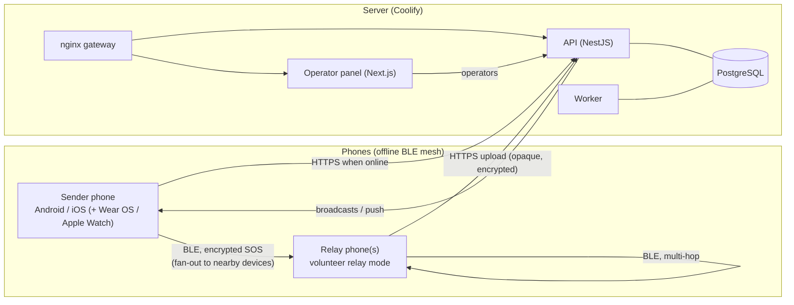

# SOSMesh — Emergency Network ("Acil Durum Ağı")

**Offline-first emergency messaging over a Bluetooth LE mesh, with a central server and operator panel.**

[](LICENSE)
[](https://nodejs.org)
[](https://pnpm.io)

> ⚠️ **SOSMesh does NOT replace 112 (Turkey) or 911 (USA) or any official emergency service.**
> It is an experimental emergency-communication prototype. Always call the official number first when you can.

**Türkçe özet:** SOSMesh (Türkçe adı **"Acil Durum Ağı"**), internet olmadığında bile SOS mesajını yakındaki telefonlar
üzerinden Bluetooth LE ile ileten bir prototiptir. Mesaj şifrelidir; gönüllü röle telefonu içeriği okuyamaz. İnternete
ulaşan bir cihaz mesajı sunucuya iletir ve operatör panelinde görünür. **112'nin yerini tutmaz**; iOS arka plan/force-quit
için mesh garantisi verilmez; fiziksel BLE başarısı yalnızca gerçek cihaz testleriyle kanıtlanır. Ayrıntılar aşağıda
(bkz. [Limitations](#limitations--known-limits)).

---

## What it is

- **Phone apps** (Android and iOS) send an SOS. If the phone is offline, the SOS is handed over BLE to nearby devices.
  The SOS sender tries **every nearby BLE device** (fan-out), including ones that are online themselves.
- **Relay mode** (opt-in, "Volunteer relay"): a phone carries encrypted SOS packets for others and uploads them when it has
  internet. Packets can hop between devices (limits in [docs/protocol/mesh-v2.md](docs/protocol/mesh-v2.md): `maxHops` 8,
  24 h time-to-live).
- **Wear OS watch** (`apps/android/wear`) and **Apple Watch** (`apps/watchos`) companions (watch SOS; Wear OS also has a relay toggle screen).
- **Central server** at <https://sosmesh.antiosoft.com>: API, operator web panel, background worker and PostgreSQL.
- **Encrypted SOS:** only the origin device and the server hold plaintext. Relays handle opaque bytes and cannot read the SOS.

### Safety invariants (see [docs/protocol/mesh-v2.md](docs/protocol/mesh-v2.md) §0)

- Relays never decrypt. A peer ACK is **not** a server receipt; only a verified server signature marks a message delivered.
- Offline BLE delivery works **without** any AI call or internet.
- SOS is never blocked by a missing profile, rate limit or missing peers; the 112 call button stays visible on SOS screens.
- No secrets, real GPS or health data in the repo or logs.

## Architecture



| Component | Path | Notes |
| --- | --- | --- |
| API | `apps/api` | NestJS + Prisma. Ingest (`/v1/ingest`), operator, broadcast, notifications, media, relay-status modules. |
| Worker | `apps/api/src/worker-main.ts` | Same codebase, own entry point (`pnpm --filter @sosmesh/api start:worker`) and container. |
| Operator panel | `apps/web` | Next.js (TR/EN). |
| Android | `apps/android` | Kotlin, Compose, Hilt, Room; modules `app`, `core/*`, `feature-sos`, `feature-relay`, `feature-status`, `mesh-v2`, `wear`. |
| iOS / watchOS | `apps/ios`, `apps/watchos` | Swift/SwiftUI, Core Bluetooth; local package `SOSMeshCore`; Apple Watch targets live in the iOS Xcode project. |
| Wear OS | `apps/android/wear` | Gradle module `:wear` (see `apps/wearos/README.md`). |
| Shared contracts | `packages/*` | `contracts` (schemas, protocol v2, test vectors), `contracts-kotlin`, `contracts-swift`, `ble-protocol`, `transport`, `fixtures`, `design-tokens`. |
| Protocol | `docs/protocol/` | `ble-v1.md` (GATT transfer), `mesh-v2.md` (relay/fan-out/receipts). |

## Features present in code

**Phones (Android + iOS)**
- Offline SOS over BLE, with relay mode and SOS fan-out to all nearby devices.
- **Relay page** with a "people you helped" counter; it counts only messages of **others** that you forwarded, never your own SOS.
- Photo and voice attachments are uploaded **by the sender, only when online**. If you send an SOS while offline with a photo or
  voice attached, the app shows a notice ("Photos and voice recordings can only be sent when you're online…"); the text SOS is still
  relayed over the mesh and is not blocked. Attachments are not carried by relays.
- Notifications page and broadcast handling, including the **relay request** notification with **"Röleyi aç"** (turn relay on) and
  **"İptal"** (cancel) actions.
- Notifications: **Android uses FCM**; **iOS uses local notifications** (the app polls for active broadcasts; no APNs push is required).
- Full **Turkish / English** localization (Android resources, iOS `Localizable.strings`, operator panel i18n).
- 112 call button on SOS screens.

**Operator panel (`apps/web`, path `/operator`)**
- **Dashboard** with stats and a regional situation view ("Bölgesel Durum": clusters of active incidents with a deterministic
  severity/urgency score and urgency filter).
- **SOS incidents / cases** list, map and case detail with live feed (SSE), tasks, teams, activity/audit and system health pages.
- **"Bildirim gönder" (Broadcasts):** compose a standard notification (title, body, severity, expiry) or a **relay request**
  (buttons "Röleyi aç" / "İptal"), optionally targeted to a region chosen by address (country → province → district →
  neighbourhood → street), with confirm step and history. Broadcasts are signed by the server and verified on devices.
- TR/EN UI.

**Server-side AI (optional, off by default)**
- The API contains an AI pipeline (triage, transcription, photo analysis, translation, fusion, mission copilot) behind
  `AI_ENABLED` (default `false` in `.env.example` and the production compose file). Everything is advisory: **AI never makes
  rescue, treatment or triage decisions for operators**, and the offline mesh does not depend on it. See
  [docs/META_AI_INTEGRATION.md](docs/META_AI_INTEGRATION.md).

## Repository layout

```
apps/
  api/        NestJS API + worker entry point, Prisma schema/migrations
  web/        Next.js operator panel
  android/    Android app (+ wear/ Wear OS, core/*, feature-*, mesh-v2)
  ios/        iOS app, SOSMeshCore (Swift package), CoreBLE, widget
  watchos/    Apple Watch sources (targets in apps/ios/SOSMesh.xcodeproj)
  wearos/     Wear OS notes/state-sync docs
packages/     contracts, contracts-kotlin, contracts-swift, ble-protocol, transport, fixtures, design-tokens
docs/         protocol, ADRs, runbooks, architecture, UX, release notes
infra/        deploy (Dockerfiles, compose, nginx, k8s templates), compose, backup, monitoring
scripts/      verification, smoke, secret-scan, release helpers
tests/        load, chaos, UX/a11y, screenshots
.github/workflows/  ci.yml, deploy-container-smoke.yml
```

## Local development quick start

Prerequisites: Node.js ≥ 20, pnpm ≥ 9, Docker (PostgreSQL/Redis); Android Studio (Android) and Xcode on macOS (iOS).

```bash
git clone https://github.com/suleymantarsuslu/sosmesh.git
cd sosmesh
pnpm bootstrap                 # checks Node/pnpm, pnpm install --frozen-lockfile, creates .env if missing
cp .env.example .env           # if bootstrap did not; never commit real secrets
docker compose up -d postgres redis
pnpm --filter @sosmesh/api db:migrate
pnpm dev                       # API on :3001, operator panel on :3000
```

More detail: [docs/getting-started.md](docs/getting-started.md).

Useful root commands (`package.json`): `pnpm build`, `pnpm test`, `pnpm lint`, `pnpm format`, `pnpm ux:test-a11y`,
`pnpm test:secret-scan`, `pnpm test:cycles`. Smoke test (needs PostgreSQL): `bash scripts/smoke.sh`.
Worker (after `pnpm build`): `pnpm --filter @sosmesh/api start:worker`.

**Android** (`apps/android`, minSdk 26, targetSdk 35):
```bash
cd apps/android
./gradlew assembleProdDebug testDebugUnitTest lint
```
The Firebase `google-services.json` is **not** in git; provide your own locally for FCM.

**iOS** (`apps/ios`, iOS 17+, watchOS 10+): open `apps/ios/SOSMesh.xcodeproj` in Xcode (schemes `SOSMesh-iOS`, `SOSMesh-Watch`).
Core logic tests on any platform with Swift: `cd apps/ios/SOSMeshCore && swift test`. Setup: [docs/ios/setup.md](docs/ios/setup.md).

## Testing and CI

- API / web: Jest (`apps/api`) and Vitest (`apps/web`) via `pnpm test`; Playwright accessibility tests via `pnpm ux:test-a11y`.
- Cross-language contract vectors for TypeScript, Kotlin and Swift; secret scan; dependency-cycle check; load smoke.
- GitHub Actions (`.github/workflows/ci.yml`) runs verify, contracts, Android Gradle, iOS Xcode, Swift package tests and
  secret-scan jobs. Runners are selected by repository variables: **self-hosted** runners (Linux ARM64 and a macOS machine) when
  enabled, otherwise GitHub-hosted. See [docs/ci/README.md](docs/ci/README.md).
- Test evidence and its status: [TEST_RESULTS.md](TEST_RESULTS.md). Real-device BLE results are tracked separately.

## Deployment

Production runs on **Coolify** from branch `deploy/vulut-coolify` using `infra/deploy/compose/docker-compose.vulut.yml`:
PostgreSQL, a one-shot migrate job, API, worker, web and an nginx gateway (TLS is terminated by Coolify's Traefik;
`/health`, `/health/ready` and `/v1/*` go to the API, everything else to the web panel). Secrets are injected as environment
variables by Coolify and are never committed. Details: [infra/deploy/README.md](infra/deploy/README.md) and
[docs/runbooks/deploy.md](docs/runbooks/deploy.md).

## Limitations / known limits

- **Not a replacement for 112/911.** Prototype; no delivery guarantee.
- **No guarantee of iOS background or force-quit mesh behaviour.** iPhones are not 24/7 relays; Apple background limits apply
  (see `docs/research/ios-multihop.md`, `docs/compat/ios-background-matrix.csv`). iOS multi-hop forwarding is behind an
  experimental setting that is off by default.
- **Physical BLE success is proven only by real-device tests.** Simulators and unit tests do not prove it; CI does not run
  BLE hardware. Cross-device results are tracked in `docs/tests/` and `docs/compat/`.
- Photos and voice are not carried over the mesh; they upload only from the sender when it is online.
- A peer ACK means "a nearby device received it", not that the server or an operator has seen it.
- **AI never decides** rescue, treatment or triage on behalf of operators; it is optional and disabled by default.
- Project status and open items: [docs/handover/status.json](docs/handover/status.json),
  [docs/handover/tech-debt.md](docs/handover/tech-debt.md).

## Documentation

- [ARCHITECTURE.md](ARCHITECTURE.md) · [docs/architecture/system-diagram.md](docs/architecture/system-diagram.md) ·
  [docs/architecture/requirements-map.md](docs/architecture/requirements-map.md) · [docs/adr/](docs/adr/)
- Protocols: [docs/protocol/ble-v1.md](docs/protocol/ble-v1.md), [docs/protocol/mesh-v2.md](docs/protocol/mesh-v2.md)
- [HACKATHON_SUBMISSION.md](HACKATHON_SUBMISSION.md) · [DEMO_SCRIPT.md](DEMO_SCRIPT.md) · [docs/META_AI_INTEGRATION.md](docs/META_AI_INTEGRATION.md)
- [SECURITY.md](SECURITY.md) · [CONTRIBUTING.md](CONTRIBUTING.md) (Conventional Commits) · [CHANGELOG.md](CHANGELOG.md)

## License

See [LICENSE](LICENSE).

---

**⚠️ Emergency disclaimer / Acil durum uyarısı:** SOSMesh is a prototype. In a real emergency call **112** (Turkey) / **911** (USA).
SOSMesh prototip bir sistemdir; gerçek bir acil durumda önce **112**'yi arayın.
