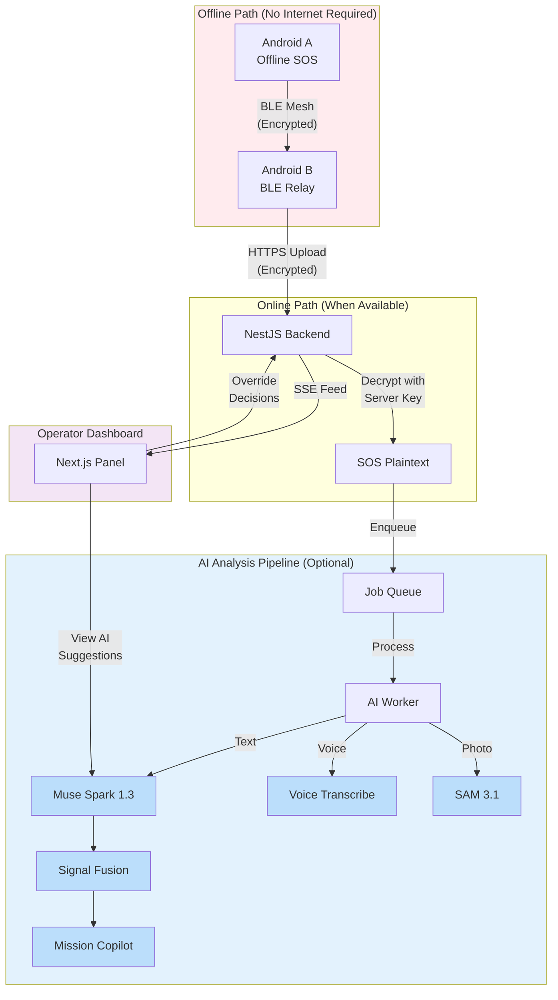

# SOSMesh — Meta AI Multimodal Disaster Intelligence

**Emergency Mesh Network with AI-Powered Response Coordination**

[](LICENSE)
[](https://nodejs.org)
[](https://pnpm.io)
[](https://dev.meta.ai)

> ⚠️ **IMPORTANT:** This system does NOT replace official emergency services (112 in Turkey, 911 in USA). This is an experimental emergency communication mesh network prototype.

---

## Project Overview

SOSMesh is a **multimodal AI-powered disaster intelligence platform** that enables emergency communication when cellular and internet infrastructure fails. The system combines **offline-first BLE mesh networking** with **Meta AI multimodal analysis** to provide intelligent emergency response coordination.

**What makes SOSMesh unique:**
- **Offline-first mesh:** SOS messages relay device-to-device via BLE when internet is unavailable
- **Multimodal AI intelligence:** Text, voice, and photo analysis using Meta AI models
- **Privacy-by-design:** Relay devices cannot read encrypted SOS content
- **AI-augmented coordination:** Intelligent triage, signal fusion, and mission copilot for operators
- **Zero AI dependency:** The core offline mesh path works without any AI or internet connection

### Multimodal AI Layer

SOSMesh integrates three Meta AI models for disaster intelligence:

1. **Muse Spark 1.3** - Intelligent SOS triage, event classification, urgency assessment, multilingual translation, signal fusion rationale, and mission copilot queries
2. **Muse Voice Transcribe 1.0** - Real-time speech-to-text for voice SOS notes with automatic language detection
3. **SAM 3.1** (Segment Anything Model) - Photo segmentation to identify visible objects in disaster scene images

**AI operates server-side only.** The operator dashboard shows AI suggestions clearly labelled; operators make all final decisions. The offline BLE mesh path works independently of AI availability.

### Architecture Overview



**Key architectural principles:**
- **Offline BLE mesh works without AI** — core SOS delivery is AI-independent
- **Server-side decryption only** — relay devices see encrypted envelopes
- **AI suggests, operators decide** — all AI outputs are advisory
- **Budget guards** — configurable cost caps prevent runaway expenses
- **Graceful degradation** — system continues when AI is unavailable

---

## Project Structure

```
sosmesh-monorepo/
├── apps/
│   ├── api/          # NestJS backend API
│   ├── web/          # Next.js operator dashboard
│   ├── android/      # Kotlin native Android app
│   └── ios/          # Swift native iOS/watchOS app
├── packages/
│   ├── contracts/    # Shared JSON schemas & TypeScript types
│   └── design-tokens/# Design system tokens (colors, spacing, typography)
├── docs/             # Documentation & ADRs
├── prototypes/       # UX prototypes (HTML/CSS)
├── scripts/          # Build & validation scripts
└── tests/            # Cross-package integration tests
```

---

## Quick Start

### Hızlı kurulum (smoke)

```bash
git clone https://github.com/suleymantarsuslu/sosmesh.git
cd sosmesh
pnpm bootstrap
cp .env.example .env   # secret repoya gitmez; MODEL_API_KEY boş bırakılabilir

pnpm -r build
pnpm test
bash scripts/smoke.sh   # PostgreSQL gerekir (CI veya yerel PG)
```

Operatör mock yedek demo (yalnız geliştirme/CI): `OPERATOR_E2E_MOCK=1` — panelde **DEMO MODE** bandı görünür; **production build’de devre dışı** (`apps/web/lib/config.test.ts`).

Mimari diyagram: [docs/architecture/system-diagram.md](docs/architecture/system-diagram.md) · Gereksinim haritası: [docs/architecture/requirements-map.md](docs/architecture/requirements-map.md) · M0 fiziksel prosedür: [docs/tests/m0-physical-report.md](docs/tests/m0-physical-report.md)

### Gizlilik, güvenlik ve sınırlamalar

- **112/911 yerine geçmez** — deneysel mesh prototipi; resmî acil hatları kullanın.
- **Mesh/BLE garantisi yok** — Apple arka plan, force-quit, OEM kısıtları; yalnızca doğrulanmış senaryolar iddia edilir.
- **Fiziksel BLE** yalnızca gerçek cihaz kanıtıyla (`NOT_TESTED` ise simülatör PASS sayılmaz).
- **AI karar vermez** — operatör panelinde öneri/taslak; Meta anahtarı yoksa AI **BLOCKED_SECRET**.
- **Röle SOS metnini görmez** — şifreli envelope; yasak düz metin alanları ingest’te reddedilir.
- **Demo/mock** ayrı etiketli; gerçek acil verisi repoya/loglara yazılmaz.

### Prerequisites

- **Node.js** 20+
- **pnpm** 8+
- **Docker** (optional, for local PostgreSQL/Redis)
- **Android Studio** (for Android development)
- **Xcode** (for iOS/watchOS development, macOS only)

### Installation

```bash
# Clone repository
git clone <repo-url>
cd sosmesh-monorepo

# Bootstrap (install dependencies & setup .env)
pnpm bootstrap

# Copy environment template and configure
cp .env.example .env
# Edit .env with your API keys and secrets

# Start services (Docker)
docker compose up -d

# Run database migrations
cd apps/api
pnpm prisma migrate dev
cd ../..

# Start all dev servers
pnpm dev
```

**Access Points:**
- API: http://localhost:3001
- Web Dashboard: http://localhost:3000

For detailed setup instructions, see [Getting Started Guide](docs/getting-started.md).

---

## Development

### Available Commands

```bash
# Install dependencies
pnpm install

# Build all packages
pnpm build

# Run all dev servers (parallel)
pnpm dev

# Lint all code
pnpm lint

# Format code
pnpm format

# Run tests
pnpm test

# Run UX accessibility tests
pnpm ux:test-a11y

# Clean all build artifacts
pnpm clean
```

### Linting & Formatting

- **JavaScript/TypeScript:** ESLint + Prettier
- **Kotlin:** ktlint + detekt
- **Swift:** SwiftLint + swift-format

Configuration files: `.eslintrc.js`, `.prettierrc.json`, `.editorconfig`, `.editorconfig-kt`, `detekt.yml`, `.swiftlint.yml`, `.swift-format`

---

## Documentation

### Hackathon Submission (Meta AI 2026)

- **📋 Hackathon Submission:** [HACKATHON_SUBMISSION.md](HACKATHON_SUBMISSION.md) — Problem, solution, Meta AI usage, impact
- **🏗️ System Architecture:** [ARCHITECTURE.md](ARCHITECTURE.md) — Complete system design with offline BLE mesh and AI pipeline
- **🤖 Meta AI Integration:** [docs/META_AI_INTEGRATION.md](docs/META_AI_INTEGRATION.md) — How each Meta model is used
- **✅ Test Results:** [TEST_RESULTS.md](TEST_RESULTS.md) — Real CI runs, test evidence, pending validations
- **🎬 Demo Script:** [DEMO_SCRIPT.md](DEMO_SCRIPT.md) — 3-minute judge walkthrough

### Technical Documentation

- **Getting Started:** [docs/getting-started.md](docs/getting-started.md)
- **Architecture Decisions (ADRs):** [docs/adr/](docs/adr/)
- **System diagram (Mermaid):** [docs/architecture/system-diagram.md](docs/architecture/system-diagram.md)
- **Requirements map:** [docs/architecture/requirements-map.md](docs/architecture/requirements-map.md)
- **AI Architecture Audit:** [docs/ai-architecture-audit.md](docs/ai-architecture-audit.md)
- **Master Plan:** [docs/SOSMesh_Tam_Gelistirme_Master_Plani.docx](docs/SOSMesh_Tam_Gelistirme_Master_Plani.docx)
- **Status Tracking:** [docs/handover/status.json](docs/handover/status.json)
- **UX Design System:** [docs/ux/](docs/ux/)
- **Tech Debt Register:** [docs/handover/tech-debt.md](docs/handover/tech-debt.md)

---

## Contributing

We welcome contributions! Please read [CONTRIBUTING.md](CONTRIBUTING.md) for guidelines.

**Commit Convention:** We use [Conventional Commits](https://www.conventionalcommits.org/)

```
feat(api): add SOS message ingestion endpoint
fix(web): correct map marker clustering
docs(adr): add ADR-005 for push notification strategy
chore(deps): upgrade Prisma to v5.8
```

---

## Testing

### Backend Tests
```bash
cd apps/api
pnpm test
```

### Web Tests
```bash
cd apps/web
pnpm test
```

### Mobile Tests
- **Android:** Run instrumented tests in Android Studio
- **iOS:** Run unit/UI tests in Xcode

### UX Accessibility Tests (Playwright)
```bash
pnpm ux:test-a11y
```

---

## Deployment

_(To be documented in production deployment guide)_

---

## License

See [LICENSE](LICENSE) file for details.

---

## Support

For questions, issues, or feature requests, please open an issue on the repository.

---

**⚠️ Emergency Disclaimer:** SOSMesh is a prototype. Always use official emergency services (112/911) in real emergencies.
