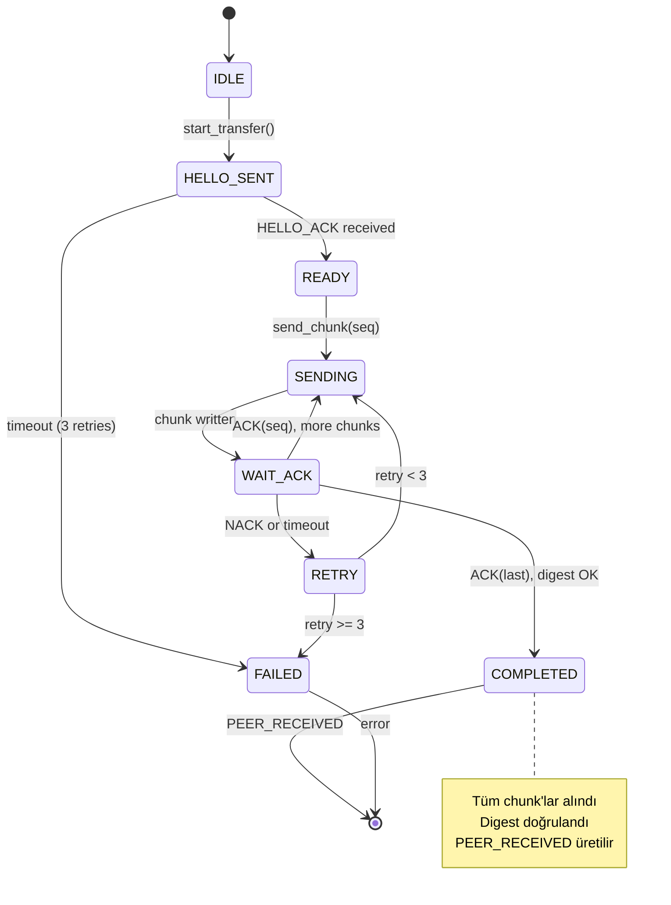

# ADR-008: BLE V1 Protocol Design

**Durum:** Kabul Edildi  
**Tarih:** 2026-10-29  
**Karar Veren:** SOSMesh Ekip  
**Bağlantı:** ADIM 08, ADR-007 (Protocol V1 Schema)

## Bağlam

SOSMesh uygulaması offline ağ kesintilerinde Bluetooth Low Energy (BLE) üzerinden peer-to-peer SOS mesajı iletimi sağlamalı. Düşük bant genişliği, kesintili bağlantı ve güvenlik gereksinimlerini karşılayan bir protokol tasarımı gerekli.

### Kritik Gereksinimler

1. **Düşük Bant Genişliği**: BLE MTU sınırları (tipik 23-512 bayt)
2. **Güvenilirlik**: Packet loss, duplicate, reorder durumlarında doğru teslim
3. **Gizlilik**: Röle node'ları hassas SOS metnini görmez
4. **Resume**: Kesilen transfer kaldığı yerden devam edebilir
5. **ACK Ayrımı**: Peer ACK ≠ Server ACK ≠ Operator Read (ADR-007 ile tutarlı)

## Karar

### 1. GATT Profili

**Service UUID:** `0000FFF0-0000-1000-8000-00805F9B34FB` (SOSMesh Custom Service)

**Characteristics:**
- **Control (RW):** `0000FFF1` - Handshake, control messages
- **Data (W):** `0000FFF2` - Chunk transfer (sender → receiver)
- **Ack (RW):** `0000FFF3` - ACK/NACK responses

**Advertisement:**
- Service UUID
- Flags: General Discoverable, BR/EDR Not Supported
- **Opaque Identifier (4 bytes):** Rotasyonlu, zaman bazlı, SOS içeriği/GPS sızdırmaz
- **Version (1 byte):** Protocol version = 0x01

**YASAK (Advertisement'ta):**
- SOS metni
- GPS koordinatları
- Kullanıcı PII
- Mesaj özeti

### 2. Handshake ve Chunk Negotiation

```
Sender → Receiver: HELLO
  version: 1
  nonce: random 16 bytes
  mtu: sender's preferred MTU

Receiver → Sender: HELLO_ACK
  version: 1
  nonce_echo: sender's nonce
  mtu: receiver's preferred MTU
  
Negotiated:
  chunk_size = min(sender_mtu, receiver_mtu) - 3 (ATT overhead) - header_size
```

**Handshake Timeout:** 5 saniye  
**Retry:** 3 deneme, exponential backoff (1s, 2s, 4s)

### 3. Chunk Format

```
Header (12 bytes):
  seq: uint16 (0-indexed)
  total: uint16
  crc32: uint32 (chunk payload CRC)
  flags: uint8
    bit 0: FIRST_CHUNK
    bit 1: LAST_CHUNK
    bit 2-7: reserved
  reserved: 3 bytes

Payload: variable (chunk_size - 12 bytes)
```

**Full Message Digest:**
- SHA-256 of complete assembled message
- Son chunk'ta LAST_CHUNK flag set
- LAST_CHUNK içinde digest (32 bytes) payload'un başında

### 4. Transfer Protocol



### 5. ACK Seviyeleri (ADR-007 ile Birebir)

Transfer başarılı tamamlanınca **yalnızca** `PEER_RECEIVED` üretilir:

```
DEVICE_STORED      → Cihazda kaydedildi (local, BLE öncesi)
PEER_RECEIVED      → Mesh peer tam ve doğru aldı (BLE transfer tamamlandı)
RELAY_FORWARDED    → Röle iletti (BLE hop, digest kontrol etmeden)
SERVER_RECEIVED    → Sunucu aldı (internet bağlantısı sonrası)
OPERATOR_VIEWED    → Operatör gördü (backend)
INCIDENT_OPENED    → Vaka açıldı (backend)
```

**Kritik:** Peer ACK ≠ Server ACK ≠ Operator Read

### 6. Resume Mekanizması

Disconnect durumunda:
```
Receiver → Sender: RESUME_REQUEST
  message_id: opaque identifier
  received_chunks: bitmap or list of seq numbers
  
Sender: Eksik chunk'ları yeniden gönder
```

**Resume Window:** 60 saniye içinde yeniden bağlanırsa resume mümkün

### 7. Backpressure ve Flow Control

**Window Size:** 4 chunk (aynı anda maksimum 4 chunk ACK beklenebilir)  
**Timeout:** Chunk başına 2 saniye  
**Jitter:** Retry'da random 0-500ms jitter

### 8. Güvenlik ve Gizlilik

**ADR-007 Integration:**
```json
{
  "envelope": {
    "timestamp": "...",
    "location": {"latitude": 0, "longitude": 0, "accuracy": 0},
    "priority": 1,
    "ackLevel": "PEER_RECEIVED"
  },
  "encryptedPayload": "BASE64_ENCRYPTED_SOS_TEXT"
}
```

**BLE Transfer:**
- **Chunk'larda:** Envelope + encryptedPayload serialize edilmiş hali
- **Röle:** Sadece envelope görür (digest doğrulama için)
- **Hassas Metin:** encryptedPayload opak kalır

**Redaction:**
- Loglarda payload/GPS koordinatları REDACTED
- Event trace: msgId hash, seq, event type, timestamp
- Güvenli debug: JSONL format, PII yok

### 9. Error Handling

**Negatif Durumlar:**
- Bozuk CRC → NACK, retry
- Yanlış digest → FAILED, asla PEER_RECEIVED yok
- Sürüm uyumsuzluğu → HELLO_ACK reject
- Total mismatch (seq >= total) → FAILED
- Timeout (3 retry sonrası) → FAILED
- Duplicate chunk → Ignore (idempotent)

### 10. Test Stratejisi

**Mock Transport:**
- Simüle edilmiş loss, duplicate, reorder
- Seed'li deterministik rastgelelik
- Minimum 1000 senaryo

**Test Vektörleri:**
- Chunking (mesaj → chunks)
- CRC32 hesaplama
- SHA-256 digest
- Handshake sequence
- Resume scenarios

**Platform Cross-Check:**
- TypeScript referans implementasyon
- Kotlin ve Swift test vektörlerini doğrular (CI)

## Sonuçlar

### Pozitif

- Düşük bant genişliğinde güvenilir transfer
- Resume capability (kesinti toleransı)
- Gizlilik korunuyor (röle hassas metni görmez)
- ADR-007 ACK seviyeleriyle tutarlı
- Test edilebilir (mock transport)

### Negatif

- BLE fiziksel katman test edilemiyor (mock ile protokol kanıtı)
- Complexity: durum makinesi, windowing, resume
- Latency: chunk-by-chunk ACK overhead

### Riskler

- **Fiziksel BLE Başarısı İddia Edilmez:** Bu tasarım mock transport ile protokol ve durum makinesi doğruluğunu kanıtlar. Gerçek cihazlarda BLE stack entegrasyonu ayrı bir adımdır.
- **MTU Negotiation:** Gerçek cihazlarda MTU farklılıkları olabilir

## Alternatifler

1. **Sliding Window (TCP-like):** Daha kompleks, BLE için overkill
2. **Stop-and-Wait:** Daha basit ama çok yavaş
3. **No Resume:** Basit ama kesinti toleransı yok

## Referanslar

- ADR-007: Protocol V1 Schema (envelope/encryptedPayload)
- BLE GATT Specification
- CRC32: IEEE 802.3
- SHA-256: FIPS 180-4
