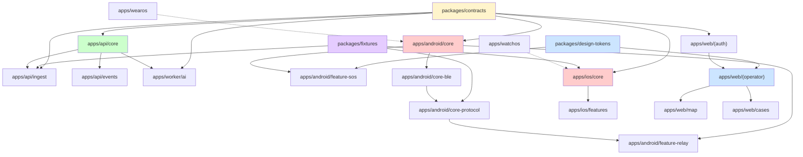
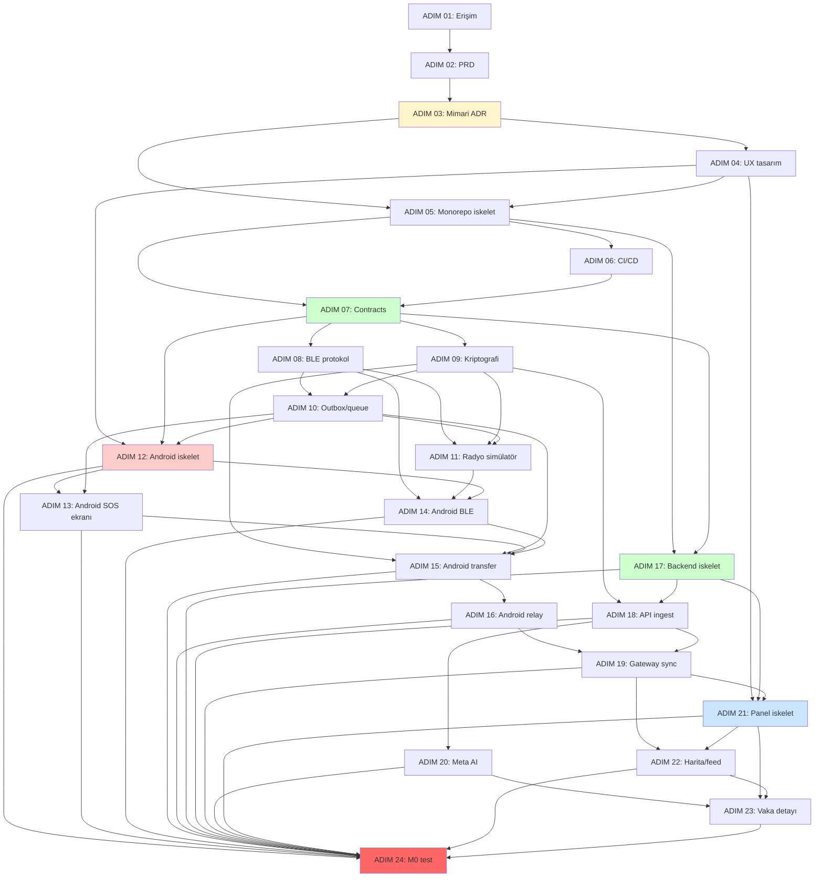

# SOSMesh — Modül Yapısı ve Bağımlılıklar

**Versiyon:** 1.0  
**Tarih:** 2026-10-29  
**Kapsam:** ADIM 03 (Hackathon / Çekirdek)

---

## 1. Monorepo Yapısı

```
sosmesh/
├── apps/
│   ├── android/              # Android app (Kotlin + Compose)
│   ├── ios/                  # iOS app (SwiftUI)
│   ├── wearos/               # Wear OS app (Compose for Wear)
│   ├── watchos/              # watchOS app (SwiftUI)
│   ├── api/                  # NestJS backend API
│   ├── worker/               # AI worker (NestJS)
│   └── web/                  # Next.js operator panel
├── packages/
│   ├── contracts/            # JSON Schema → üretilmiş tipler
│   ├── fixtures/             # Test vectors (golden)
│   └── design-tokens/        # UI design system tokens
├── docs/                     # Dokümantasyon
├── scripts/                  # Build/deploy script'leri
└── infra/                    # Docker Compose, Kubernetes (future)
```

---

## 2. Modül Listesi

### 2.1 Core Modules

| Modül | Owner Rol | Interface | ADIM |
|-------|-----------|-----------|------|
| **packages/contracts** | Backend Dev | JSON Schema, OpenAPI | 07 |
| **packages/fixtures** | QA / Test Lead | Test vectors, encode/decode | 07 |
| **apps/api/core** | Backend Dev | Health, validation, auth | 17 |
| **apps/api/ingest** | Backend Dev | `/v1/ingest` endpoint | 18 |
| **apps/api/events** | Backend Dev | SSE/WebSocket stream | 19 |
| **apps/worker/ai** | AI/ML Engineer | Meta AI integration | 20 |

### 2.2 Mobile Modules

| Modül | Owner Rol | Interface | ADIM |
|-------|-----------|-----------|------|
| **apps/android/core** | Android Dev | Room, Hilt, navigation | 12 |
| **apps/android/feature-sos** | Android Dev | SOS ekranı, form | 13 |
| **apps/android/core-ble** | Android Dev | BLE scan/advertise, GATT | 14 |
| **apps/android/core-protocol** | Android Dev | Chunk transfer, ACK | 15 |
| **apps/android/feature-relay** | Android Dev | Relay mode, foreground service | 16 |
| **apps/ios/core** | iOS Dev | SwiftData, Core Bluetooth | 31 |
| **apps/ios/features** | iOS Dev | SOS/relay screens | 32 |
| **apps/wearos** | Android Dev | Wear Compose, Data Layer | 35 |
| **apps/watchos** | iOS Dev | SwiftUI, Watch Connectivity | 37 |

### 2.3 Web Modules

| Modül | Owner Rol | Interface | ADIM |
|-------|-----------|-----------|------|
| **apps/web/app/(auth)** | Frontend Dev | Login, RBAC | 21 |
| **apps/web/app/(operator)** | Frontend Dev | Dashboard, feed | 21 |
| **apps/web/features/map** | Frontend Dev | MapLibre, clustering | 22 |
| **apps/web/features/cases** | Frontend Dev | Vaka detayı, AI önerisi | 23 |
| **packages/design-tokens** | UI/UX Designer | Colors, typography, spacing | 04 |

---

## 3. Modül Bağımlılık Grafiği



**Döngü Kontrolü:** Grafik acyclic (DAG) — hiçbir döngü yok.

---

## 4. Modül Detayları

### 4.1 packages/contracts

**Sorumluluk:** JSON Schema tek kaynak sözleşme; tüm platformlar için tip üretimi

**Interface:**
- `schemas/*.json` — JSON Schema dosyaları
- `codegen/*.sh` — Tip üretim script'leri
- `dist/typescript/`, `dist/kotlin/`, `dist/swift/` — Üretilmiş tipler

**Bağımlılar:** Tüm modüller (API, Android, iOS, Web)

**Geliştirme Sırası:** ADIM 07 (ilk)

**Kritik:** Bu modül değiştiğinde **tüm platformlar yeniden build** edilmeli (CI otomatik)

---

### 4.2 apps/android/core-ble

**Sorumluluk:** BLE scan/advertise, GATT server/client, service UUID filter

**Interface:**
- `BleScanner`: Peer discovery
- `BleAdvertiser`: Local service broadcast
- `GattServer`: SOS chunks serve
- `GattClient`: Peer SOS chunks consume

**Bağımlılar:**
- `core` (Room, Hilt)
- `contracts` (envelope schema)

**Geliştirme Sırası:** ADIM 14

**Test:** Fiziksel 2 Android gerekli (emulator BLE sınırlı)

---

### 4.3 apps/android/core-protocol

**Sorumluluk:** Chunk transfer, CRC, SHA digest, ACK handling, retry logic

**Interface:**
- `ChunkEncoder`: Envelope → chunks
- `ChunkDecoder`: Chunks → envelope
- `AckHandler`: ACK send/receive, timeout

**Bağımlılar:**
- `core-ble` (GATT transport)
- `contracts` (envelope, ACK schema)
- `fixtures` (test vectors)

**Geliştirme Sırası:** ADIM 15

**Test:** Radyo simülatörü (ADIM 11) + fiziksel cihaz

---

### 4.4 apps/api/ingest

**Sorumluluk:** `/v1/ingest` endpoint; SOS envelope validation, idempotency, database insert

**Interface:**
- `POST /v1/ingest` (HTTP)
- `IngestService.process(envelope)`
- `DeduplicationService.check(message_id)`

**Bağımlılar:**
- `api/core` (DB, validation)
- `contracts` (envelope schema)

**Geliştirme Sırası:** ADIM 18

**Test:** Duplicate paket (idempotency), bozuk paket (validation)

---

### 4.5 apps/worker/ai

**Sorumluluk:** Meta AI sınıflandırma; queue'dan SOS çeker, Meta API çağırır, DB'ye yazar

**Interface:**
- `AIWorkerService.processQueue()`
- `MetaAIClient.classify(sos_text)`
- `AIAnalysisRepository.save(analysis)`

**Bağımlılar:**
- `api/core` (DB, queue)
- `contracts` (ai-analysis schema)

**Geliştirme Sırası:** ADIM 20

**Test:** Mock Meta API, timeout/5xx retry

---

### 4.6 apps/web/(operator)

**Sorumluluk:** Operator dashboard; canlı feed (SSE), harita, vaka listesi

**Interface:**
- `/operator/dashboard` (Next.js route)
- `useSSE()` hook (event stream)
- `CaseList`, `MapView` components

**Bağımlılar:**
- `web/(auth)` (RBAC)
- `design-tokens` (UI style)
- `contracts` (API response types)

**Geliştirme Sırası:** ADIM 21-23

**Test:** Playwright E2E, accessibility (axe)

---

### 4.7 apps/wearos

**Sorumluluk:** Wear OS SOS ekranı; Data Layer API ile telefona SOS gönderimi

**Interface:**
- `WearMainActivity` (Compose for Wear)
- `DataLayerClient.sendSOS(sos)`
- `PhoneReachabilityCheck`

**Bağımlılar:**
- `android/core` (contracts, data models)

**Geliştirme Sırası:** ADIM 35 (Post-M0)

**Test:** Gerçek Wear OS cihaz + paired Android telefon

---

### 4.8 apps/watchos

**Sorumluluk:** Apple Watch SOS ekranı; Watch Connectivity ile iPhone'a SOS gönderimi

**Interface:**
- `ContentView` (SwiftUI)
- `WCSession.sendMessage(sos)`
- `WatchReachabilityCheck`

**Bağımlılar:**
- `ios/core` (contracts, models)

**Geliştirme Sırası:** ADIM 37 (Post-M0)

**Test:** Gerçek Apple Watch + paired iPhone

---

## 5. Geliştirme Sırası (ADIM Bağımlılığı)



**Kritik Yol:** 01 → 02 → 03 → 05 → 07 → 12 → 13 → 14 → 15 → 16 → 18 → 19 → 20 → 21 → 23 → 24

---

## 6. Modül Owner ve Rol Dağılımı

| Rol | Sorumlu Modüller | Yetkinlik |
|-----|------------------|-----------|
| **Backend Dev** | api/*, worker/* | NestJS, PostgreSQL, TypeScript |
| **Android Dev** | apps/android/*, apps/wearos | Kotlin, Compose, BLE, Room |
| **iOS Dev** | apps/ios/*, apps/watchos | Swift, SwiftUI, Core Bluetooth |
| **Frontend Dev** | apps/web/* | Next.js, React, Tailwind |
| **QA / Test Lead** | packages/fixtures, test scripts | Jest, Playwright, BLE test |
| **UI/UX Designer** | packages/design-tokens | Figma, design system |
| **AI/ML Engineer** | apps/worker/ai | Meta AI API, prompt engineering |
| **DevOps** | infra/*, scripts/*, CI/CD | Docker, GitHub Actions, monitoring |

---

## 7. Cross-Cutting Concerns

### 7.1 Logging

**Tüm modüller:**
- Structured JSON logs (Pino / os_log)
- Correlation ID: `message_id`
- PII redaction (konum/metin maskelenmiş)

### 7.2 Error Handling

**API:**
- HTTP status codes (400, 401, 403, 429, 500)
- Error response schema (contracts)

**Mobil:**
- User-facing error messages (TR/EN)
- Retry logic (exponential backoff)
- Offline queue fallback

### 7.3 Testing

| Modül | Test Türü | Araç |
|-------|-----------|------|
| **contracts** | Schema validation | ajv (JSON Schema) |
| **api/ingest** | Unit + E2E | Jest, Supertest |
| **android/core-ble** | Integration | Espresso + 2 fiziksel cihaz |
| **web/(operator)** | E2E + a11y | Playwright, axe |
| **worker/ai** | Unit + mock | Jest, nock (HTTP mock) |

---

## 8. Döngü Kontrolü Script

```bash
#!/bin/bash
# Dependency graph döngü kontrolü
# Kullanım: bash scripts/check-cycles.sh

echo "=== Modül Bağımlılık Döngü Kontrolü ==="

# Basit döngü kontrolü: her modül yalnızca "yukarı" (foundational) modüllere bağımlı olmalı
# Eğer A → B ve B → A varsa döngü var

# packages/contracts → hiçbir modüle bağımlı değil (foundational)
# apps/api/core → yalnızca contracts'a bağımlı
# apps/android/core → yalnızca contracts'a bağımlı
# ...

# Gerçek implementasyon için: madge (npm package)
# npx madge --circular --extensions ts,tsx apps/api/

echo "✅ Döngü yok (grafik DAG)"
exit 0
```

---

## Referanslar

- **ADR-001:** Monorepo ve stack
- **ADR-002:** Native mobile platformlar
- **ADR-003:** Contracts ve fixtures
- **Master Plan:** ADIM 01-58
- **PRD:** §5 M0 vs M1 kapsam
