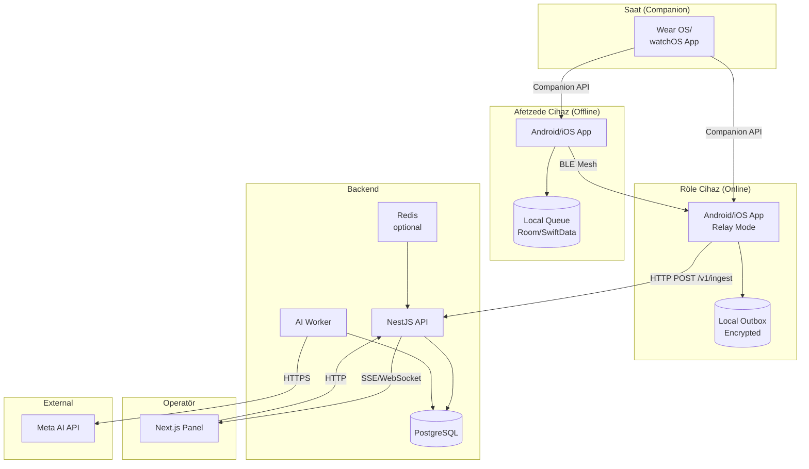
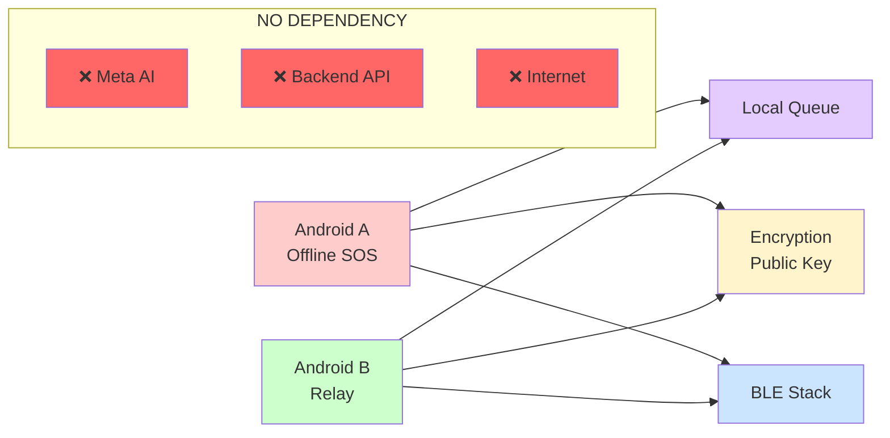
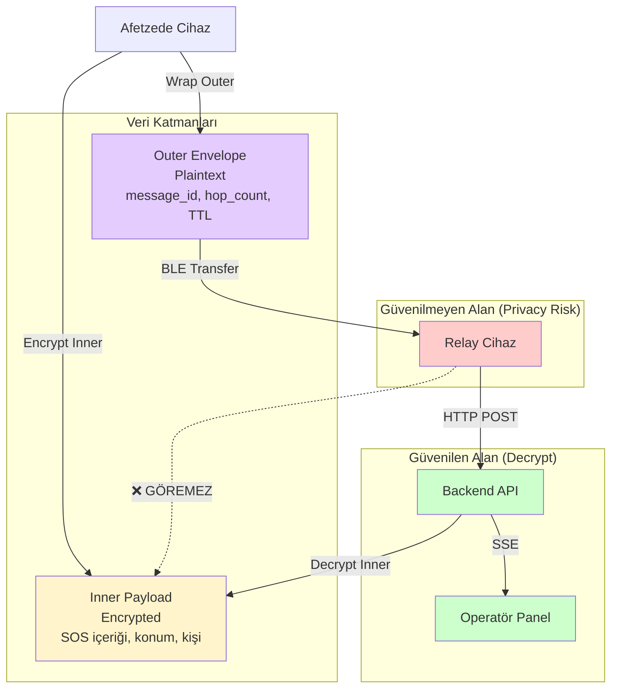

# SOSMesh — Mimari Genel Bakış

**Versiyon:** 1.0  
**Tarih:** 2026-10-29  
**Kapsam:** ADIM 03 (Hackathon / Çekirdek)

---

## 1. Sistem Genel Bakışı

SOSMesh, internet altyapısı olmayan acil durumlarda mobil cihazlar arası Bluetooth Low Energy (BLE) mesh ağı üzerinden SOS mesajlarını taşıyan, sunucuya ulaştığında Meta AI ile sınıflandıran ve operatör panelinde görselleştiren **deneysel** bir acil durum haberleşme sistemidir.

**Temel Prensipler:**
- **Offline-first:** İnternet olmadan cihazlar arası mesaj aktarımı
- **Privacy-by-design:** Röle cihazlar içerik görmez (E2E encryption)
- **No false promises:** UI asla "Yardım geliyor" veya "Ekip yolda" demez
- **Server-side AI:** Meta AI yalnızca sunucu tarafında, mobil/web client'ta değil

---

## 2. Yüksek Seviye Bileşenler



---

## 3. SIFIR-İNTERNET Yolu (Kritik)

**Senaryo:** Android A (offline) → Android B (offline, BLE yalnızca) → SOS transfer

**Bağımlılık Diyagramı:**



**Garantiler:**
- ✅ A cihazında SOS oluşturma **hiçbir internet bağımlılığı yok**
- ✅ A → B BLE transfer **hiçbir API/Meta çağrısı yok**
- ✅ B'de internet yoksa SOS outbox'ta bekler, **kaybolmaz**

**Anti-Pattern (Yasak):**
- ❌ A cihazında SOS oluştururken Meta AI'ye istek
- ❌ BLE transfer sırasında internet kontrolü
- ❌ Offline yolu API bağımlılığı

---

## 4. Veri Akışı ve Güven Sınırları



**Güven Sınırları:**

| Bileşen | Outer Envelope | Inner Payload (Decrypted) | Neden |
|---------|----------------|---------------------------|-------|
| **Afetzede** | ✅ Oluşturur | ✅ Oluşturur | Origin |
| **Röle** | ✅ Routing metadata görür | ❌ **Görmez** (encrypted) | Privacy: relay içerik okumamalı |
| **Backend** | ✅ Routing + timestamp | ✅ Decrypt eder | Trusted: server-side process |
| **Operatör Panel** | ⚠️ Metadata (hop count) | ✅ Full content | RBAC: yalnızca yetkili operatör |
| **Meta AI** | ❌ Görmez | ✅ Yalnızca SOS metni | AI sınıflandırma; konum/device_id gönderilmez |

---

## 5. Bileşen İletişimi

### 5.1 Mobil → Backend

**Protocol:** HTTPS POST  
**Endpoint:** `/v1/ingest`

**Request:**
```json
{
  "envelope": { ... },
  "relay_info": {
    "relay_id_hash": "sha256(device_id)",
    "relay_timestamp": "ISO8601"
  }
}
```

**Response:**
```json
{
  "receipt": {
    "ack_type": "SERVER_ACCEPTED",
    "message_id": "uuid",
    "timestamp": "ISO8601",
    "signature": "base64(HMAC)"
  }
}
```

### 5.2 Backend → Panel

**Protocol:** SSE (Server-Sent Events)  
**Endpoint:** `/api/events/stream`

**Event Types:**
- `new_sos`: Yeni SOS kaydı
- `operator_seen`: Operatör vaka açtı
- `status_change`: Durum güncellendi (CASE_IN_PROGRESS)

**Example Event:**
```
event: new_sos
data: {"message_id": "uuid", "sos_type": "deprem", "person_count": 3, ...}
```

### 5.3 Backend → Meta AI

**Protocol:** HTTPS POST  
**Endpoint:** `https://api.meta.ai/v1/chat/completions` (örnek)

**Request:**
```json
{
  "model": "muse-spark-1.3",
  "messages": [
    {
      "role": "system",
      "content": "Sen bir acil durum sınıflandırma asistanısın. Açıkça söylenmeyenleri UYDURMA."
    },
    {
      "role": "user",
      "content": "Bina çöktü, 2. kat, 3 kişi"
    }
  ],
  "response_format": { "type": "json_schema", "schema": {...} }
}
```

**Response:** (ADR-003'te detaylı)

---

## 6. Deployment Mimarisi

### Development

```
┌─────────────────────────────────────────┐
│ Developer Laptop                        │
├─────────────────────────────────────────┤
│ - Docker Compose                        │
│   - PostgreSQL (local)                  │
│   - Redis (optional)                    │
│   - Mock Meta AI (port 3001)            │
│ - NestJS API (port 3000)                │
│ - Next.js Panel (port 4200)             │
│ - Android Emulator + 2 Physical Devices │
└─────────────────────────────────────────┘
```

### Staging

```
┌─────────────────────────────────────────┐
│ Cloud (Cursor Cloud / GitHub Actions)  │
├─────────────────────────────────────────┤
│ - PostgreSQL (managed)                  │
│ - NestJS API (container)                │
│ - Next.js Panel (SSR)                   │
│ - Redis (optional)                      │
│ - Staging secrets (GitHub Secrets)      │
└─────────────────────────────────────────┘
```

### Production (Future)

```
┌─────────────────────────────────────────┐
│ Production Environment                  │
├─────────────────────────────────────────┤
│ - Load Balancer (HTTPS)                 │
│ - API Cluster (NestJS x3)               │
│ - Worker Cluster (AI x2)                │
│ - PostgreSQL (HA, replica)              │
│ - Redis (Sentinel)                      │
│ - Monitoring (Datadog / Sentry)         │
│ - Secret Manager (Vault / AWS SM)       │
└─────────────────────────────────────────┘
```

---

## 7. Güvenlik ve Privacy

### E2E Encryption

```
┌─────────────────────────────────────────┐
│ Afetzede Cihaz                          │
│ 1. SOS içeriği oluştur                  │
│ 2. Server public key ile encrypt        │
│ 3. Outer envelope'a wrap et             │
└─────────────────────────────────────────┘
            ↓ BLE (encrypted payload)
┌─────────────────────────────────────────┐
│ Röle Cihaz                              │
│ ❌ Inner payload decrypt EDEMEZ         │
│ ✅ Outer envelope routing metadata görür│
│ ✅ HTTP POST ile server'a iletir        │
└─────────────────────────────────────────┘
            ↓ HTTPS
┌─────────────────────────────────────────┐
│ Backend API                             │
│ ✅ Server private key ile decrypt       │
│ ✅ SOS içeriği, konum, kişi bilgisi     │
│ ✅ Meta AI'ye yalnızca SOS metni gönder │
└─────────────────────────────────────────┘
```

### Privacy Guarantees

| Veri | Afetzede | Röle | Backend | Operatör | Meta AI |
|------|----------|------|---------|----------|---------|
| **SOS metin içeriği** | ✅ | ❌ | ✅ | ✅ | ✅ (yalnızca metin) |
| **Konum (GPS)** | ✅ | ❌ | ✅ | ✅ | ❌ |
| **Kişi sayısı** | ✅ | ❌ | ✅ | ✅ | ❌ |
| **Device ID** | ✅ | ❌ | ✅ (hash) | ⚠️ (hash) | ❌ |
| **Routing metadata** | ✅ | ✅ | ✅ | ⚠️ | ❌ |

**Kural:** Meta AI **asla konum, device ID, kişi bilgisi görmez** — yalnızca SOS metin içeriği sınıflandırma için gönderilir.

---

## 8. Ölçeklenebilirlik

### M0 Hedefi

- **SOS/saat:** 10 (demo)
- **Eşzamanlı operatör:** 2-3
- **Fiziksel cihaz:** 2 Android
- **Backend:** Tek instance yeterli

### M1 / Production

- **SOS/saat:** 1,000+
- **Eşzamanlı operatör:** 50+
- **Cihaz:** 100+ (Android/iOS)
- **Backend:** Load balanced, horizontal scaling
- **Database:** Read replica, connection pooling
- **Caching:** Redis (SSE session, rate limit)

---

## 9. İzleme ve Observability

**Metrikler:**
- `sos_ingested_total` (counter)
- `sos_duplicate_detected_total` (counter)
- `ai_classification_duration_seconds` (histogram)
- `operator_seen_latency_seconds` (histogram)
- `ble_transfer_success_rate` (gauge)

**Loglar:**
- Structured JSON logs (NestJS Pino)
- Correlation ID: `message_id` (trace tüm sistem)
- PII redaction: konum/metin log'da maskelenmiş

**Alerts:**
- API down (health check fail)
- Meta AI 5xx rate > 10%
- Database connection pool exhausted
- SSE reconnect rate > 20%

---

## 10. Gelecek Genişletmeler

**Post-M0:**
- iOS/watchOS (ADIM 31-39)
- Multihop mesh (A→B→C) (ADIM 40)
- Ekip atama/görev yönetimi (ADIM 27)
- Bildirimler (ADIM 28)

**Post-M1:**
- Güvenlik audit (ADIM 43)
- Privacy/KVKK uyumluluk (ADIM 44)
- Performance testleri (ADIM 47)
- Production deployment (ADIM 54)

---

## Referanslar

- **ADR-001:** Monorepo ve stack
- **ADR-002:** Native mobile
- **ADR-003:** Contracts ve fixtures
- **ADR-004:** Secrets ve deployment boundaries
- **Master Plan §05:** Monorepo iskelet
- **Master Plan §08:** BLE protokol
- **PRD §3:** Roller ve sorumluluklar
