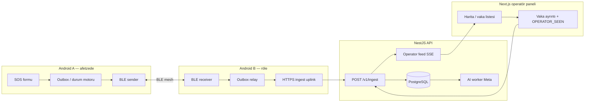

# SOSMesh sistem diyagramı (M0)

## Veri sınırları

- Röle cihazları şifreli **envelope** taşır; SOS düz metni röle UI’sında görünmez.
- AI yalnızca backend worker’da; operatör UI’da **öneri/taslak** etiketi.
- Peer ACK, operatör görüldü (OPERATOR_SEEN) olayından ayrıdır.

## İlgili dokümanlar

- [overview.md](./overview.md)
- [requirements-map.md](./requirements-map.md)
- [../handover/status.json](../handover/status.json)
