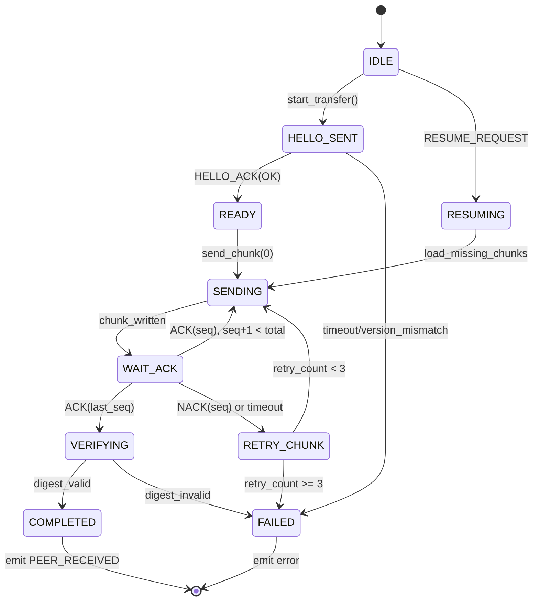

# BLE V1 Protocol Specification

**Version:** 1.0  
**Date:** 2026-10-29  
**Status:** Draft

## Overview

SOSMesh BLE V1 protokolü, Bluetooth Low Energy üzerinden düşük bant genişliğinde güvenilir, gizli, parçalı SOS mesaj aktarımı sağlar.

## GATT Profile

### Service

- **UUID:** `0000FFF0-0000-1000-8000-00805F9B34FB`
- **Name:** SOSMesh Transfer Service

### Characteristics

| Characteristic | UUID | Properties | Description |
|---------------|------|------------|-------------|
| Control | `0000FFF1` | Read, Write | Handshake, control commands |
| Data | `0000FFF2` | Write | Chunk data transfer |
| Ack | `0000FFF3` | Read, Write, Notify | ACK/NACK responses |

## Advertisement

```
Flags: 0x06 (General Discoverable, BR/EDR Not Supported)
Service UUID: 0xFFF0
Manufacturer Data:
  Company ID: 0xFFFF (test/development)
  Data:
    [0]: Protocol Version (0x01)
    [1-4]: Opaque Identifier (4 bytes, rotasyonlu)
```

**Opaque Identifier Generation:**
```
opaque_id = HMAC-SHA256(secret_key, timestamp_hour)[0:4]
```
- Saat bazlı rotasyon
- SOS içeriği/GPS sızdırmaz
- Aynı cihaz farklı saatlerde farklı ID

## Handshake Protocol

### HELLO Message

```
Type: 0x01 (HELLO)
Version: 0x01
Nonce: 16 bytes (random)
MTU: uint16 (sender's preferred MTU, e.g. 512)
```

### HELLO_ACK Message

```
Type: 0x02 (HELLO_ACK)
Version: 0x01
Nonce Echo: 16 bytes (sender's nonce)
MTU: uint16 (receiver's preferred MTU)
Status: 0x00 (OK) or error code
```

**Negotiation:**
```
chunk_size = min(sender_mtu, receiver_mtu) - 3 (ATT) - 12 (header)
```

**Timeouts:**
- HELLO wait: 5 seconds
- Retry: 3 attempts with exponential backoff (1s, 2s, 4s)

## Chunk Format

```
+------------------+
| Header (12 bytes)|
+------------------+
| Payload (variable|
+------------------+

Header:
  seq: uint16 (0-indexed, big-endian)
  total: uint16 (big-endian)
  crc32: uint32 (IEEE 802.3, big-endian)
  flags: uint8
    bit 0: FIRST_CHUNK
    bit 1: LAST_CHUNK
    bit 2-7: reserved
  reserved: 3 bytes (0x00)
```

**Last Chunk Special Format:**
```
Last Chunk Payload:
  digest: 32 bytes (SHA-256 of complete assembled message)
  remaining_data: variable
```

## State Machine



## ACK Protocol

### ACK Message

```
Type: 0x10 (ACK)
Seq: uint16 (acknowledged chunk sequence)
Status: 0x00 (OK)
```

### NACK Message

```
Type: 0x11 (NACK)
Seq: uint16 (failed chunk sequence)
Reason: uint8
  0x01: CRC_MISMATCH
  0x02: SEQUENCE_ERROR
  0x03: TIMEOUT
  0x04: BUFFER_FULL
```

### Flow Control

**Window Size:** 4 chunks  
**Timeout per Chunk:** 2 seconds  
**Retry Jitter:** random(0, 500ms)

## Resume Protocol

### RESUME_REQUEST

```
Type: 0x20 (RESUME_REQUEST)
Received count: uint16 BE
Transfer ID: 16 bytes (HELLO nonce)
Received seq list: received_count × uint16 BE (sorted ascending önerilir)
```

**Resume Window:** 60 seconds after disconnect (policy; mock tests use simulated clock)

### Resume Flow

1. Receiver sends RESUME_REQUEST with transfer ID and received seq numbers
2. Sender validates transfer ID; mismatch → reject (no data sent)
3. Sender marks listed seqs as ACKed and resends only missing chunks
4. Normal ACK flow continues until digest verified → PEER_RECEIVED

## Error Handling

| Error | Code | Action |
|-------|------|--------|
| CRC Mismatch | 0x01 | NACK, sender retry |
| Sequence Error | 0x02 | NACK, sender resend |
| Version Mismatch | 0x10 | HELLO_ACK reject |
| Digest Invalid | 0x11 | FAILED, no PEER_RECEIVED |
| Total Mismatch | 0x12 | FAILED |
| Timeout | 0x20 | Retry (max 3), then FAILED |

**Critical:** Digest validation başarısız → asla PEER_RECEIVED emit edilmez

## Security and Privacy

### Message Structure (ADR-007)

```json
{
  "envelope": {
    "timestamp": "2026-10-29T17:00:00Z",
    "location": {"latitude": 0, "longitude": 0},
    "priority": 1,
    "ackLevel": "PEER_RECEIVED"
  },
  "encryptedPayload": "BASE64_ENCRYPTED_TEXT"
}
```

**BLE Transfer:**
- Envelope + encryptedPayload serialize edilir
- Chunks: serialize edilmiş binary
- Röle: envelope parse edebilir, encryptedPayload opak

### Logging Redaction

**Event Trace Format (JSONL):**
```json
{"ts":1698604800,"event":"chunk_sent","msgId":"a3f2b1c0","seq":0,"total":5}
{"ts":1698604801,"event":"ack_received","msgId":"a3f2b1c0","seq":0}
{"ts":1698604802,"event":"transfer_complete","msgId":"a3f2b1c0","digest":"SHA256_HASH"}
```

**Redacted Fields:**
- payload (encryptedPayload value)
- GPS coordinates (location values)
- Raw bytes
- PII

**Allowed:**
- Message ID hash (first 8 hex chars of SHA-256)
- Sequence numbers
- Event types
- Timestamps
- CRC/digest hashes (not content)

## Test Requirements

### Mock Transport

- Simüle packet loss (0-50%)
- Duplicate chunks
- Out-of-order delivery
- Configurable latency (10-1000ms)
- Disconnect/reconnect scenarios

### Test Vectors

**Required Coverage:**
1. Chunking: 5KB message → chunks
2. CRC32: known inputs → expected CRC
3. SHA-256: known messages → expected digest
4. Handshake: HELLO → HELLO_ACK sequence
5. Resume: partial transfer → resume → complete

**Negative Tests:**
1. Bozuk CRC → NACK
2. Yanlış digest → FAILED
3. Sürüm uyumsuzluğu → HELLO_ACK reject
4. Total mismatch → FAILED
5. Timeout → retry → FAILED

### Fuzz Testing

- Seed'li deterministik random
- Minimum 1000 scenarios
- Seed loglanır (reproducible)
- Metrics: success rate, duplicate detection, resume success

## Implementation Notes

### Platform Support

- **TypeScript:** Referans implementasyon (packages/ble-protocol)
- **Kotlin:** Test vektörlerini doğrular
- **Swift:** Test vektörlerini doğrular

### Physical BLE Disclaimer

**Bu protokol tasarımıdır, mock transport ile doğrulanır.**  
Fiziksel BLE başarısı (cihazlarda çalışma) iddia edilmez.  
Gerçek cihaz entegrasyonu ayrı bir adımdır.

## References

- ADR-007: Protocol V1 Schema
- ADR-008: BLE V1 Protocol Design
- BLE Core Specification 5.3
- CRC32: IEEE 802.3
- SHA-256: FIPS 180-4
