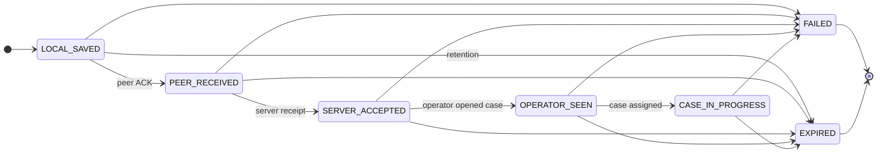

# SOS delivery state chart (transport)

Outbox entries track **encrypted payload blobs** and metadata only (no plaintext GPS or health fields in the queue).

## Progress states

## Semantics

| State | Meaning | UX TR label (timeline) |
| --- | --- | --- |
| `LOCAL_SAVED` | Encrypted SOS persisted on device outbox | CİHAZDA KAYITLI |
| `PEER_RECEIVED` | Verified mesh peer ACK only | YAKIN CİHAZA AKTARILDI |
| `SERVER_ACCEPTED` | Server ingest receipt | SUNUCUYA ULAŞTI |
| `OPERATOR_SEEN` | Operator viewed case | OPERATÖR GÖRDÜ |
| `CASE_IN_PROGRESS` | Case under coordination | VAKA İŞLEME ALINDI |

**Important:** `PEER_RECEIVED` does **not** imply server or operator acknowledgment.

## Shared transition table

All implementations load transitions from [`packages/fixtures/transport/state-transitions.json`](../../packages/fixtures/transport/state-transitions.json).

## Platform notes

| Platform | Persistence | CI coverage |
| --- | --- | --- |
| TypeScript reference | SQLite file (`better-sqlite3`) | PASS |
| Kotlin JVM adapter | SQLite via JDBC (Room-portable interface) | PASS |
| Swift Linux | Atomic JSON file queue | PASS |
| Android Room | Target adapter | NOT_TESTED |
| iOS device | Target adapter | NOT_TESTED |
