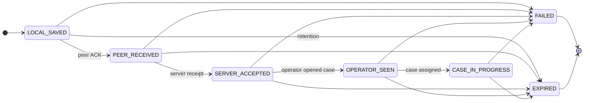

# SOS delivery state chart (transport)

Outbox entries track **encrypted payload blobs** and metadata only (no plaintext GPS or health fields in the queue).

## Progress states

## Semantics

| State | Meaning | UX TR label (timeline) |
| --- | --- | --- |
| `LOCAL_SAVED` | Encrypted SOS persisted on device outbox | CİHAZDA KAYITLI |
| `PEER_RECEIVED` | Verified mesh peer ACK only | YAKIN CİHAZA AKTARILDI |
| `SERVER_ACCEPTED` | Server ingest receipt | SUNUCUYA ULAŞTI |
| `OPERATOR_SEEN` | Operator viewed case | OPERATÖR GÖRDÜ |
| `CASE_IN_PROGRESS` | Case under coordination | VAKA İŞLEME ALINDI |

**Important:** `PEER_RECEIVED` does **not** imply server or operator acknowledgment.

## Shared transition table

All implementations load transitions from [`packages/fixtures/transport/state-transitions.json`](../../packages/fixtures/transport/state-transitions.json).

## Retention, expiry, and “SOS kaybolmasın”

Store-and-forward keeps **undelivered** encrypted envelopes on disk while `retry_at` and delivery states allow send attempts. That goal is **not** contradicted by retention:

- **`expires_at`** is a **policy ceiling** (default 7 days from fixture). It applies when an SOS never reaches a terminal success path and the organization’s retention rule says the encrypted copy must be erased from the device relay queue.
- **Before `expires_at`:** the row stays on disk through app restarts, SIGKILL, and offline backoff; UX shows the last honest delivery state (for example still `LOCAL_SAVED` or `PEER_RECEIVED`).
- **At `expires_at`:** `purgeExpired` removes the ciphertext from the outbox. The user should see an explicit expired / no longer queued state (not “delivered”). This is **not** silent success; it is auditable deletion of a message that was **not** accepted by the server within the retention window.
- **Delivered or terminal paths:** once the incident is `SERVER_ACCEPTED` or moved to operator workflow, server-side retention applies; the mobile outbox may still drop the relay copy after sync ack, separate from the expiry TTL for stuck messages.

Formula (all languages): `retry_at = now + min(3600000, 60000 * 2^max(0, attempt-1))`.

## Platform notes

| Platform | Persistence | CI coverage |
| --- | --- | --- |
| TypeScript reference | SQLite file (`better-sqlite3`) | PASS |
| Kotlin JVM adapter | SQLite via JDBC (Room-portable interface) | PASS |
| Swift Linux | Atomic JSON file queue | PASS |
| Android Room | Target adapter | NOT_TESTED |
| iOS device | Target adapter | NOT_TESTED |
