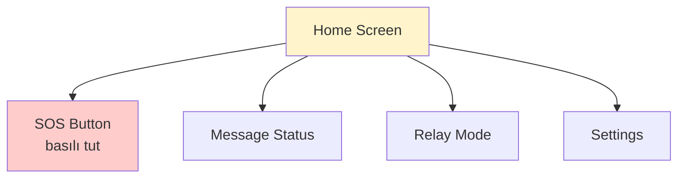
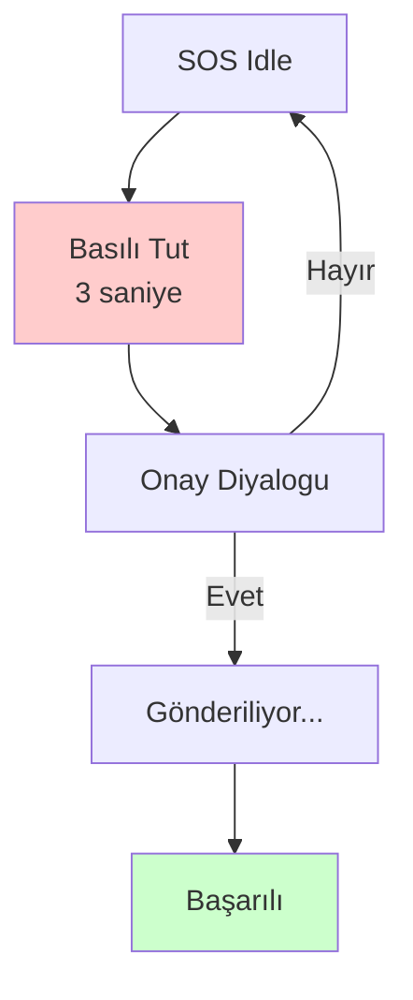
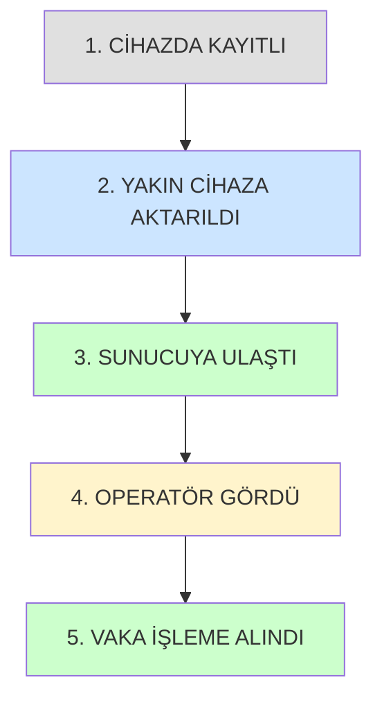
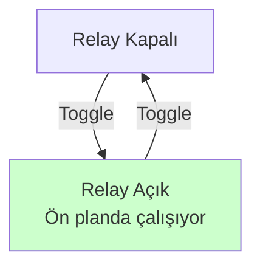
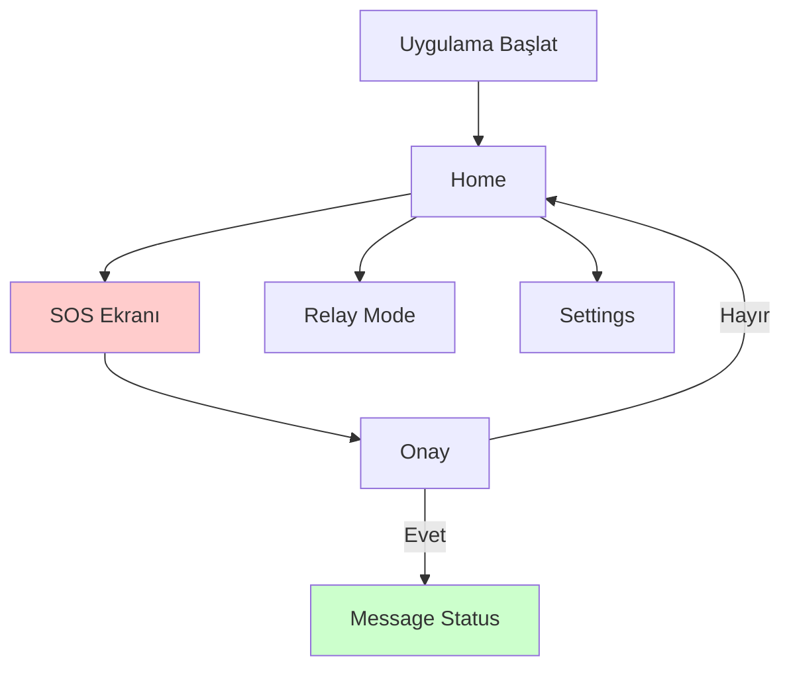

# SOSMesh — Ekran Yapısı ve Bilgi Mimarisi

**Versiyon:** 1.0  
**Tarih:** 2026-10-29  
**Kapsam:** ADIM 04 (UX Tasarım Sistemi)

---

## 1. Tasarım İlkeleri

### Afet Anı Odaklı Tasarım
- **Hız**: Birincil eylem ≤2 dokunuşta
- **Açıklık**: Tek el kullanımı, 360–430px viewport
- **Erişilebilirlik**: WCAG 2.1 AA, 200% zoom desteği
- **Duygusal Ton**: Sakin, güvenilir, yanlış umut vermeyen

### Ana Görev Eylem Sayısı Kısıtı

| Ekran | Ana Görev | Eylem Sayısı | ✅/❌ |
|-------|-----------|--------------|-------|
| Mobil Home | SOS gönder | 2 (basılı tut → onayla) | ✅ |
| Mobil SOS | SOS gönder | 2 (basılı tut → onayla) | ✅ |
| Mobil Message Status | Durum görüntüle | 1 (açıldığında görünür) | ✅ |
| Mobil Relay | Relay aktif et | 2 (toggle → onayla) | ✅ |
| Mobil Settings | İzin ver | 3 (ayarlar → izin → aç) | ✅ |
| Web Dashboard | Vakaları görüntüle | 1 (açıldığında liste) | ✅ |
| Web Map | SOS konumunu gör | 2 (harita → marker seç) | ✅ |
| Web Inbox | SOS detayını aç | 2 (liste → detay) | ✅ |
| Web Cases | AI öneri gör | 3 (vaka → detay → öneri) | ✅ |
| Web Teams | Ekip üyesi ekle | 3 (teams → üye seç → kaydet) | ✅ |
| Web Admin | İzin düzenle | 3 (admin → kullanıcı → rol değiştir) | ✅ |
| Saat SOS | SOS gönder | 3 (basılı tut → ilerleme → gönder/iptal) | ✅ |
| Saat Status | Durum görüntüle | 1 (açıldığında görünür) | ✅ |

---

## 2. Mobil Ekranlar (Android/iOS)

### 2.1 Home

**Amaç:** SOS göndermek için merkezi giriş noktası.

**Birincil Eylem:** SOS butonu (basılı tut)

**Wireframe:**

**Layout (360px):**
- **Header:** Logo + internet durumu (16dp padding)
- **SOS Button:** Ekran merkezinde, min 40vw × 120dp, kırmızı gradient
- **Alt navigasyon:** 4 tab (Home, Status, Relay, Settings), 48dp yükseklik

**Durumlar:**
- **Normal:** SOS butonu aktif
- **Offline:** "İnternet yok — Yalnız yakın cihazlara gönderilecek" banner
- **Permission Denied:** "Konum izni gerekli" uyarısı + Settings butonu
- **Low Battery:** "Pil %10'un altında — Relay modu kapalı" bilgi

**A11y:**
- SOS butonu: `role="button"`, `aria-label="SOS gönder, basılı tutun"`
- Kontrast: SOS butonu metin/arka plan ≥4.5:1
- Tek el erişimi: Tüm elemanlar başparmak erişim alanında (360px × 640px thumb zone)

---

### 2.2 SOS Ekranı

**Amaç:** SOS mesajı göndermek.

**Birincil Eylem:** SOS butonu basılı tut → onay

**Wireframe:**

**İnteraksiyon:**
1. **Basılı Tut:** 3 saniye progress ring
2. **Onay:** "SOS göndermek istediğinize emin misiniz?" + Evet/Hayır
3. **Gönderiliyor:** Spinner + "Yakın cihazlar aranıyor..."
4. **Başarılı:** "SOS gönderildi" + Message Status'a yönlendir

**Durumlar:**
- **Empty:** İlk kullanım, form alanları (isteğe bağlı)
- **Loading:** Spinner + "Gönderiliyor..."
- **Error:** "Gönderilemedi — Tekrar dene" + retry butonu
- **Offline:** "İnternet yok — Yalnız BLE mesh üzerinden gönderildi"

**A11y:**
- Haptic feedback: Basılı tutma sırasında vibrasyon
- `aria-live="polite"` bölge: Durum güncellemeleri
- Fokus sırası: SOS butonu → Evet → Hayır

---

### 2.3 Message Status

**Amaç:** Gönderilen SOS'un durumunu görmek.

**Birincil Eylem:** Durum görüntüleme (pasif)

**5 Durum:**
1. **CİHAZDA KAYITLI** (gri, offline ikon)
2. **YAKIN CİHAZA AKTARILDI** (mavi, BLE ikon)
3. **SUNUCUYA ULAŞTI** (yeşil, cloud ikon)
4. **OPERATÖR GÖRDÜ** (turuncu, eye ikon)
5. **VAKA İŞLEME ALINDI** (yeşil, checkmark)

**Wireframe:**

**Layout:**
- **Timeline:** Dikey, sol kenardan başlayan çizgi
- **Her durum:** İkon + etiket + zaman damgası
- **Alt:** "Bu durum bilgisi 'yardım gelecek' anlamına gelmez" uyarısı (küçük yazı, gri)

**Durumlar:**
- **Loading:** Skeleton (5 kutu)
- **Error:** "Durum yüklenemedi" + retry
- **Empty:** "Henüz SOS gönderilmedi"

**A11y:**
- `role="status"` timeline bölgesi
- Her durum: `aria-label="2. durum: YAKIN CİHAZA AKTARILDI, 14:32"`

---

### 2.4 Relay Mode

**Amaç:** Cihazı mesh relay olarak aktifleştirmek.

**Birincil Eylem:** Relay toggle

**Wireframe:**

**Layout:**
- **Toggle:** Büyük switch (64dp), merkezde
- **Açıklama:** "Relay modu aktifken cihazınız başkalarının SOS mesajlarını aktarır" (16dp altında)
- **Uyarı:** "Pil tüketimi artar" (küçük yazı)

**Durumlar:**
- **Permission Denied:** "Konum ve Bluetooth izni gerekli"
- **Low Battery:** "Pil %10'un altında — Relay otomatik kapandı"

**A11y:**
- Switch: `role="switch"`, `aria-checked="true"`

---

### 2.5 Settings

**Amaç:** İzinler, dil, tema ayarları.

**Birincil Eylem:** İzin verme

**Layout:**
- **İzinler:** Konum, Bluetooth, Bildirimler (her biri ayrı satır, toggle)
- **Dil:** TR / EN
- **Tema:** Light / Dark / Auto
- **Hakkında:** Versiyon, lisanslar

**A11y:**
- Liste yapısı: `<ul role="list">`
- Her ayar: `role="button"` veya `role="switch"`

---

## 3. Web Ekranlar (Operator Panel)

### 3.1 Dashboard

**Amaç:** Operatör için genel bakış.

**Birincil Eylem:** Vaka listesini görmek

**Layout (1440px):**
- **Header:** Logo + kullanıcı menüsü (sağ üst)
- **Sidebar:** Dashboard, Map, Inbox, Cases, Teams, Admin (240px genişlik)
- **Main:** 3 sütun widget (toplam vaka sayısı, aktif vakalar, ortalama yanıt süresi)
- **Table:** Son 10 vaka (durum, konum, zaman)

**Durumlar:**
- **Empty:** "Henüz vaka yok"
- **Loading:** Skeleton (3 widget + tablo)
- **Error:** "Veriler yüklenemedi" + retry

**A11y:**
- Skip link: "Ana içeriğe geç"
- Sidebar: `<nav role="navigation">`
- Tablo: `<table>` + `<caption>`

---

### 3.2 Map

**Amaç:** SOS konumlarını haritada görmek.

**Birincil Eylem:** Marker seçmek

**Layout:**
- **Map:** Tam ekran (MapLibre)
- **Clustering:** 10+ marker → cluster
- **Sidebar:** Seçilen SOS detayı (sağda, 360px)

**A11y:**
- `aria-label="Harita"` map container
- Klavye: Tab ile marker'lar arası geçiş

---

### 3.3 Inbox

**Amaç:** SOS listesini görmek.

**Birincil Eylem:** SOS detayını açmak

**Layout:**
- **Liste:** Sol panel (480px), her satır: durum ikon + konum + zaman
- **Detay:** Sağ panel (960px), SOS timeline + harita + notlar

**A11y:**
- Liste: `role="list"`, `aria-label="SOS gelen kutusu"`

---

### 3.4 Cases

**Amaç:** Vaka detayını ve AI önerisini görmek.

**Birincil Eylem:** AI öneri görme (3 eylem: vaka → detay → öneri)

**Layout:**
- **Header:** Vaka ID + durum badge
- **Timeline:** SOS mesaj durumları
- **AI Öneri:** Kartlar (risk seviyesi, önerilen kaynaklar, benzer vakalar)
- **Notlar:** Operatör notları + kaydet butonu

**A11y:**
- AI öneri: `role="region"`, `aria-label="AI önerisi"`

---

## 4. Saat Ekranları (Wear OS / watchOS)

### 4.1 Saat SOS

**Amaç:** Hızlı SOS göndermek (kazara tetiklemeyi önle).

**Birincil Eylem:** Basılı tut (3 saniye) → iptal penceresi

**Layout:**
- **SOS Button:** Tam ekran, kırmızı
- **İnteraksiyon:** 3 saniye basılı tut → ilerleme halkası → geri sayım + iptal butonu

**A11y:**
- Haptic: Güçlü vibrasyon
- Sesli geri bildirim: "SOS gönderildi"

---

### 4.2 Saat Status

**Amaç:** SOS durumunu görmek.

**Layout:**
- **Timeline:** 5 durum, kompakt (ikon + etiket)
- **Scroll:** Dikey

**A11y:**
- VoiceOver/TalkBack: Her durum okunabilir

---

### 4.5 Web Ekipler (Teams)

**Amaç:** Ekip üyelerini ve görev dağıtımını yönetmek.

**Birincil Eylem:** Ekip üyesi ekle/çıkar

**Layout:**
- **Ekip listesi:** İsim, rol, durum (aktif/pasif)
- **Görev dağıtımı:** Drag-and-drop ekip üyesi atama
- **İstatistikler:** Ekip başına ortalama yanıt süresi

**Durumlar:**
- **Empty:** "Henüz ekip üyesi eklenmedi"
- **Loading:** Skeleton loader
- **Error:** "Ekip verileri yüklenemedi"
- **Offline:** "İnternet bağlantısı yok"
- **Permission Denied:** "Yönetici izni gerekli"

**A11y:**
- ARIA labels: `role="list"`, `aria-label="Ekip üyeleri"`
- Klavye: Tab ile navigasyon, Enter ile düzenle

---

### 4.6 Web Yönetim (Admin)

**Amaç:** Sistem ayarlarını ve kullanıcı izinlerini yönetmek.

**Birincil Eylem:** Kullanıcı izinlerini düzenle

**Layout:**
- **Kullanıcı yönetimi:** İzin rolleri (admin, operatör, görüntüleyici)
- **Sistem ayarları:** AI model seçimi, relay politikası
- **Audit log:** Sistem değişikliği kayıtları

**Durumlar:**
- **Empty:** "Audit log boş"
- **Loading:** Skeleton loader
- **Error:** "Ayarlar yüklenemedi"
- **Offline:** "İnternet bağlantısı yok"
- **Permission Denied:** "Sadece admin erişebilir"

**A11y:**
- Form validation: Hata mesajları `aria-describedby` ile
- Checkboxlar: `role="checkbox"`, `aria-checked`

---

## 5. Responsive Breakpoints

| Breakpoint | Viewport | Layout |
|------------|----------|--------|
| Mobile | 360–430px | Tek sütun, alt navigasyon |
| Mobile (landscape) | 640–896px | Yatay, iki sütun (isteğe bağlı) |
| Tablet | 768–1024px | İki sütun, sidebar |
| Desktop | 1440px+ | Üç sütun, sidebar + main + detay |

---

## 6. Durumlar ve Microcopy

### 6.1 Tüm Ekranlar İçin Ortak Durumlar

| Durum | Görsel | Microcopy (TR) | Microcopy (EN) |
|-------|--------|----------------|----------------|
| Empty | İkon + metin | "Henüz veri yok" | "No data yet" |
| Loading | Skeleton | — | — |
| Error | Uyarı ikon | "Yüklenemedi. Tekrar dene." | "Failed to load. Retry." |
| Offline | Bulut + çarpı | "İnternet bağlantısı yok" | "No internet connection" |
| Permission Denied | Kilit ikon | "İzin gerekli. Ayarlara git." | "Permission required. Go to settings." |
| Low Battery | Pil ikon | "Pil düşük (%10 altı)" | "Low battery (below 10%)" |

### 6.2 SOS Durumları (5 Durum)

1. **CİHAZDA KAYITLI** / **SAVED ON DEVICE**
2. **YAKIN CİHAZA AKTARILDI** / **TRANSFERRED TO NEARBY DEVICE**
3. **SUNUCUYA ULAŞTI** / **REACHED SERVER**
4. **OPERATÖR GÖRDÜ** / **OPERATOR VIEWED**
5. **VAKA İŞLEM SÜRÜYOR** / **CASE IN PROGRESS**

**Uyarı (her ekranda):**
> "Bu durum bilgisi 'yardım gelecek' veya 'güvendesiniz' anlamına gelmez. 112'yi aramayı unutmayın."

> "This status does not mean 'help is on the way' or 'you are safe'. Always call 112."

---

## 7. Erişilebilirlik Gereksinimleri

### 7.1 WCAG 2.1 AA Uyumu

- **Kontrast:** Normal metin ≥4.5:1, büyük metin/ikon ≥3:1
- **Odak:** Focus ring her etkileşimli elemanda görünür (2px solid, 2px offset)
- **Klavye:** Tüm işlevler klavye ile erişilebilir
- **Ekran okuyucu:** Tüm içerik VoiceOver/TalkBack ile okunabilir

### 7.2 200% Zoom Desteği

- **Responsive:** 200% zoom'da yatay taşma olmamalı
- **Font scaling:** `rem` birimi kullanımı
- **Min touch target:** 48dp/44pt

### 7.3 Renk Körlüğü

- **Yalnız renk kullanma:** İkon + metin kombinasyonu
- **Alternatif gösterim:** Durum badge'lerde ikon + metin

---

## 8. Wireflow (Genel)

---

## 9. Not: Native Samples (İsteğe Bağlı)

Bu adımda Compose/SwiftUI örnekleri **İSTEĞE BAĞLI** ve **NOT_TESTED** olarak işaretlenmiştir. VM'de Xcode/Android SDK bulunmadığından derlenme garantisi yoktur. Örnekler `docs/ux/native-samples/` altında referans amaçlıdır.
